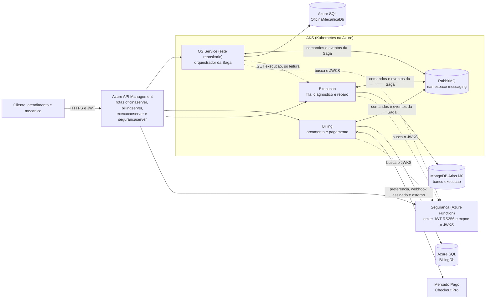
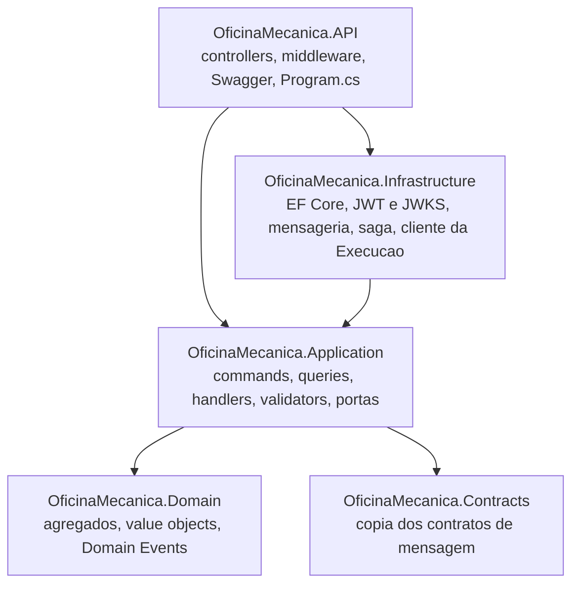
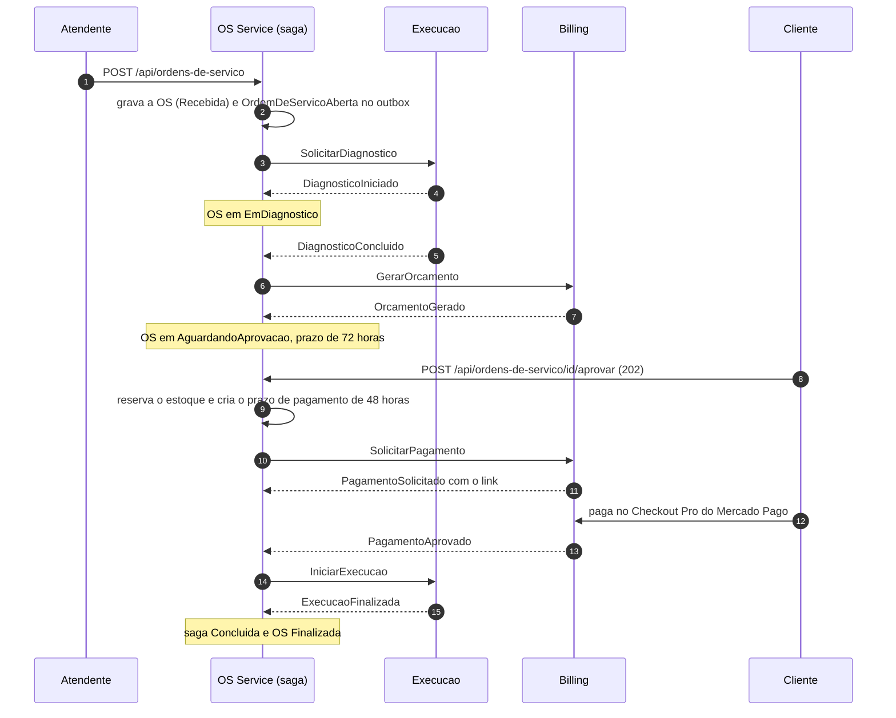
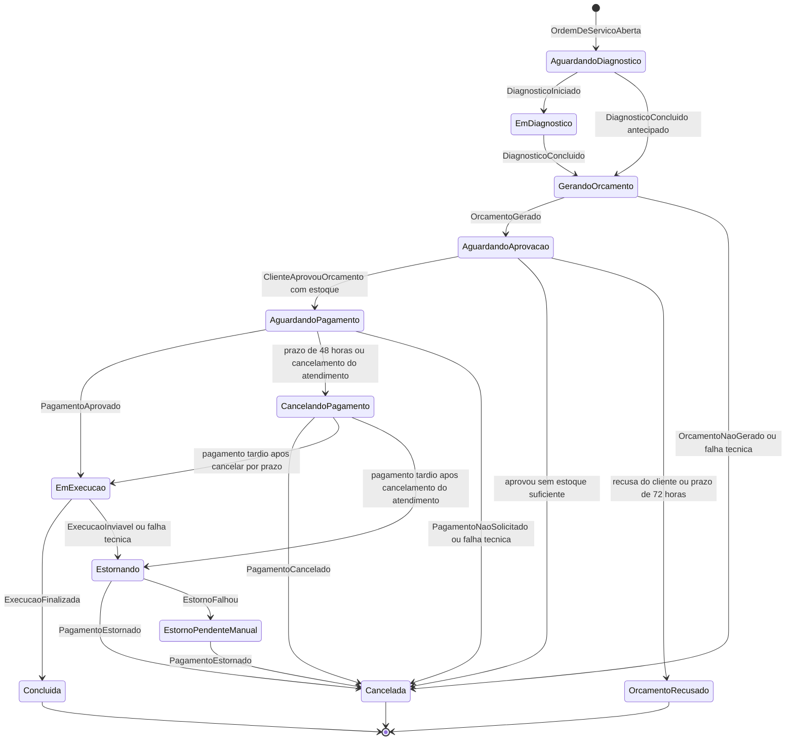
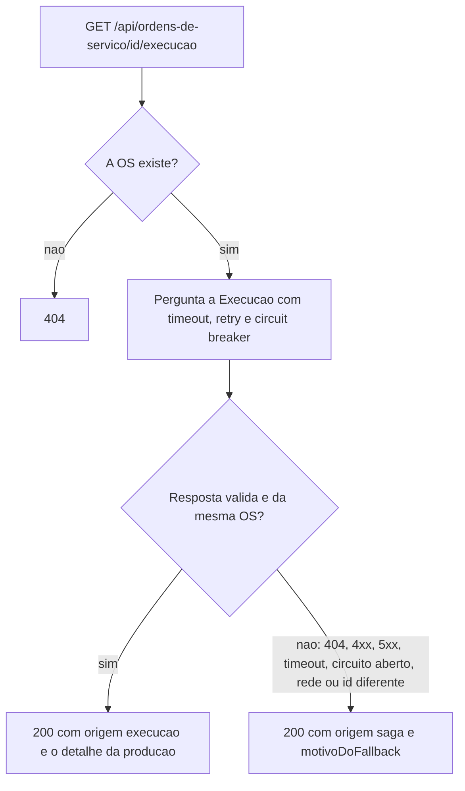

# OficinaMecanica - OS Service

Servico de **ordens de servico (OS)** do ecossistema OficinaMecanica, um sistema de
gestao para oficina mecanica. Ele cuida dos cadastros (clientes, veiculos, servicos e
pecas com estoque), do ciclo de vida da ordem de servico (abertura, status, consulta
publica e historico), da notificacao por e-mail ao cliente e, principalmente, e o
**orquestrador da Saga**: a maquina de estados que conduz cada OS por diagnostico,
orcamento, aprovacao, pagamento e reparo, coordenando dois outros servicos
(Billing e Execucao) por mensagens e desfazendo o que for preciso quando uma etapa
falha.

E um servico .NET 8 com DDD (Domain-Driven Design), Clean Architecture e CQRS
(Command Query Responsibility Segregation), com banco proprio (Azure SQL
`OficinaMecanicaDb`). Este repositorio nasceu como um monolito e evoluiu in-place
para o OS Service de uma arquitetura de microsservicos com Saga orquestrada
([RFC 0005](docs/rfc/0005-decomposicao-em-microsservicos-com-saga-orquestrada.md)).
Ele **so valida** tokens JWT (RS256, via JWKS); quem emite o token e o
`OficinaMecanica.Seguranca`.

> **Estado de publicacao: nada desta versao foi publicado.** O repositorio ja existe
> no GitHub (remoto `origin`, com `main` e `release` na versao anterior, monolitica),
> mas a branch `feature/microsservicos` so existe localmente (sem push), o workflow
> `.github/workflows/ci.yml` novo nunca rodou no GitHub Actions, nenhuma imagem desta
> versao foi enviada ao registry, nada foi implantado no cluster e o Terraform que cria
> o RabbitMQ, as rotas e os segredos dos novos servicos (repositorios
> `OficinaMecanica.Infra` e `OficinaMecanica.Banco`) nao foi aplicado. Tudo o que esta
> descrito aqui como "validado" foi executado **localmente**; o que depende da
> publicacao esta marcado como **ainda nao executado** (resumo na
> [secao 1](#1-visao-geral) e roteiro completo na
> [secao 16](#16-publicacao-ainda-nao-executada)).

Os links `../OficinaMecanica.*` deste documento apontam para os repositorios irmaos e
**so funcionam com todos clonados lado a lado**, na mesma pasta pai; em um repositorio
publicado isoladamente eles nao resolvem.

## Sumario

1. [Visao geral](#1-visao-geral)
2. [O ecossistema](#2-o-ecossistema)
3. [Arquitetura do OS Service](#3-arquitetura-do-os-service)
4. [A Saga orquestrada](#4-a-saga-orquestrada)
5. [Por que Saga orquestrada e nao coreografada](#5-por-que-saga-orquestrada-e-nao-coreografada)
6. [Comunicacao sincrona x assincrona](#6-comunicacao-sincrona-x-assincrona)
7. [API e autenticacao](#7-api-e-autenticacao)
8. [Funcionalidades de dominio](#8-funcionalidades-de-dominio)
9. [Testes e qualidade](#9-testes-e-qualidade)
10. [Observabilidade](#10-observabilidade)
11. [CI/CD e Kubernetes](#11-cicd-e-kubernetes)
12. [Como rodar localmente](#12-como-rodar-localmente)
13. [Teste ponta a ponta dos tres servicos](#13-teste-ponta-a-ponta-dos-tres-servicos)
14. [Decisoes, diagramas e relatorios](#14-decisoes-diagramas-e-relatorios)
15. [Limitacoes conhecidas e pendencias](#15-limitacoes-conhecidas-e-pendencias)
16. [Publicacao (ainda nao executada)](#16-publicacao-ainda-nao-executada)

---

## 1. Visao geral

### O que o servico faz

- **Cadastros**: clientes (CPF/CNPJ validados), veiculos (placa antiga e Mercosul),
  servicos e pecas com controle de estoque.
- **Ordem de servico**: abertura com cliente, veiculo, servicos e pecas; historico
  imutavel de status; consulta publica por numero (o cliente acompanha sem conta);
  listagem priorizada; cancelamento pelo atendimento.
- **Orquestra a Saga** da OS: pede o diagnostico a Execucao, o orcamento e o
  pagamento ao Billing, reserva e devolve estoque, controla os prazos de aprovacao e
  de pagamento e compensa cada etapa que falha (secoes
  [4](#4-a-saga-orquestrada) e [5](#5-por-que-saga-orquestrada-e-nao-coreografada)).
- **Avisa o cliente por e-mail** a cada mudanca de status e quando o link de
  pagamento fica disponivel.
- **Consulta a Execucao** (so leitura) para mostrar o andamento do reparo, com
  degradacao definida quando ela esta fora (secao [6](#6-comunicacao-sincrona-x-assincrona)).

### O que roda hoje e o que depende da publicacao

| Ja executado nesta maquina | Ainda nao executado (depende da publicacao) |
|----------------------------|---------------------------------------------|
| Build Release e **1147 testes** passando, inclusive os de infraestrutura com SQL Server e RabbitMQ reais em containers; cobertura de linhas de 96,71% (bruta) e 95,85% (com exclusoes), ver [docs/relatorios/cobertura.md](docs/relatorios/cobertura.md) | Qualquer execucao do workflow `.github/workflows/ci.yml` no GitHub Actions (a ordem dos jobs e as condicoes `if` so se provam na primeira execucao) |
| 12 cenarios BDD (Behavior-Driven Development) da Saga, com a API e a maquina de estados reais e Billing/Execucao simulados | SonarCloud (analise e Quality Gate) |
| `bash scripts/ci-local.sh`: os mesmos passos do job `Build & Test`, completo e verde em 2026-11-08 | Scan Trivy da imagem no pipeline, push no ACR (Azure Container Registry) e deploy no AKS (Azure Kubernetes Service) |
| Validacao estatica do workflow (`actionlint`), do shell (`shellcheck`) e dos manifests (`kubeconform`); `docker build` da imagem; imagem executada como usuario nao-root, com raiz somente leitura, contra SQL Server e RabbitMQ reais | Migrations aplicadas no `OficinaMecanicaDb` real (Azure SQL) e manifests aplicados em um cluster |
| Scripts de CI testados com entradas sinteticas e mutantes (`scripts/testar-scripts.sh`: 76 casos e 38 mutantes detectados) | RabbitMQ no cluster, rotas `billingserver`/`execucaoserver` na APIM, segredos dos novos servicos no Key Vault e usuarios SQL dedicados (todos criados pelos repositorios `OficinaMecanica.Infra` e `OficinaMecanica.Banco`, que nao foram aplicados) |
| Migrations validadas em SQL Server real, a partir da `Initial` | Atualizacao do ruleset de protecao de branch no GitHub (hoje exige so o `Build & Test`; o JSON versionado acrescenta o `Quality`; comando na [secao de protecao de branch](#protecao-de-branch-ruleset-versionado)) |
| Stack local com `docker compose` (API, SQL Server, RabbitMQ, Mailpit, observabilidade), com a fila da saga criada na partida | A Saga rodando contra o Billing e a Execucao reais no cluster; Azure SQL serverless acordando durante a Saga |
| Teste ponta a ponta local dos tres servicos em ambiente Docker isolado: 7 cenarios e as verificacoes finais passaram em 2026-11-08 (8 de 8, 586 asserts; [secao 13](#13-teste-ponta-a-ponta-dos-tres-servicos)) | Integracao real com o Mercado Pago (responsabilidade do Billing, nunca exercitada com credenciais reais) |

### Termos usados neste documento

| Termo | Significado |
|-------|-------------|
| OS | Ordem de servico |
| Saga | Sequencia de transacoes locais (uma por servico) em que cada etapa que muda estado tem uma **compensacao** que a desfaz; usada no lugar de uma transacao distribuida, que nao existe entre bancos independentes |
| Orquestrador | O coordenador da Saga: envia os comandos e reage aos eventos de resposta. Aqui, este servico |
| Comando x evento | Comando e um pedido a um destinatario (`GerarOrcamento`); evento e um fato ja ocorrido, anunciado por quem o produziu (`OrcamentoGerado`) |
| Outbox / inbox | Tabelas no proprio banco que tornam atomicos "gravar o estado" e "enviar a mensagem" (outbox) e descartam mensagens repetidas na entrada (inbox) |
| Idempotencia | Repetir a mesma operacao produz o mesmo resultado, sem efeito duplicado |
| Compensacao | Passo que desfaz o efeito de uma etapa anterior da Saga (devolver estoque, cancelar orcamento, estornar pagamento) |
| Sweeper | Tarefa de fundo que procura prazos vencidos no banco e os transforma em mensagens |
| Fila `_error` | Fila onde o MassTransit deposita a mensagem que falhou depois de todas as tentativas (por exemplo `billing-comandos_error`) |
| JWT / JWKS | JSON Web Token (a credencial enviada pelo cliente) / JSON Web Key Set (a chave publica que valida a assinatura do JWT) |
| APIM, AKS, ACR | Azure API Management (porta de entrada publica), Azure Kubernetes Service (cluster), Azure Container Registry (registry de imagens) |
| OIDC | OpenID Connect: o GitHub Actions troca um token de curta duracao por credencial do Azure, sem guardar senha de longa duracao |
| HPA | Horizontal Pod Autoscaler: escala o numero de replicas por uso de CPU/memoria |
| ADR / RFC | Architecture Decision Record (decisao tecnica pontual) / Request for Comments (proposta de direcao) |

---

## 2. O ecossistema

O ecossistema e formado por **tres servicos de negocio independentes** (OS, Billing e
Execucao), cada um com repositorio, banco, pipeline e manifests proprios, mais o servico
de autenticacao, a infraestrutura e os bancos. Os servicos nao tem dependencia de
compilacao entre si: so se encontram em tempo de execucao (mensagens pelo RabbitMQ e
HTTP/JWKS para a identidade). **Este servico orquestra a Saga**; o Billing e a Execucao
respondem aos comandos e nao conhecem o fluxo completo.



Linhas cheias sao mensagens ou acesso a banco; linhas tracejadas sao chamadas HTTP
sincronas (consulta de leitura e busca da chave publica). Localmente o mesmo desenho
roda com Docker Compose: APIM e AKS nao entram e o RabbitMQ e o do `docker compose`
deste repositorio (ver [secao 12](#12-como-rodar-localmente)). A rota `oficinaserver`
da APIM e o RabbitMQ do cluster so existem com a infraestrutura aplicada.

### Repositorios do ecossistema

| Repositorio | Papel | Banco |
|-------------|-------|-------|
| **OficinaMecanica** (este) | **OS Service**: cadastros, ordens de servico, e-mail ao cliente e **orquestrador da Saga** | Azure SQL `OficinaMecanicaDb` |
| [OficinaMecanica.Billing](../OficinaMecanica.Billing) | Orcamento e pagamento; integra o Mercado Pago (Checkout Pro, webhook assinado, estorno idempotente) atras de `IPagamentoGateway` (Fake em desenvolvimento) | Azure SQL `BillingDb` |
| [OficinaMecanica.Execucao](../OficinaMecanica.Execucao) | Fila de execucao, diagnostico e reparo; o mecanico reivindica itens da fila de forma atomica | MongoDB Atlas (M0), banco `execucao` |
| [OficinaMecanica.Seguranca](../OficinaMecanica.Seguranca) | Autenticacao: Azure Function que emite JWT RS256 (chave no Key Vault) e expoe `/.well-known/jwks.json` | Azure SQL `SegurancaDb` |
| [OficinaMecanica.Infra](../OficinaMecanica.Infra) | Terraform da plataforma: AKS, ACR, Key Vault, APIM, identidades OIDC, Helm (ingress-nginx, OTel Collector, New Relic), RabbitMQ no AKS e segredos | - |
| [OficinaMecanica.Banco](../OficinaMecanica.Banco) | Terraform dos bancos: Azure SQL (um banco e um usuario SQL dedicado por servico) e o cluster MongoDB Atlas M0 da Execucao | - |

### Como os repositorios se conectam

- **Sem dependencia de compilacao**: nenhum servico referencia o codigo de outro.
  Nenhum servico le ou escreve o banco de outro.
- **Mensagens**: comandos e eventos da Saga trafegam por um unico RabbitMQ (no AKS, no
  namespace `messaging`), via MassTransit 8.5.12. Cada servico tem suas filas de entrada:
  `os-saga` (este servico), `billing-comandos` e `execucao-comandos`.
- **Contratos copiados**: cada repositorio mantem a sua copia dos contratos de mensagem
  (`OficinaMecanica.Contracts.*`), travada por testes de contrato com arquivos golden JSON
  identicos entre os repositorios ([ADR 0005](docs/adr/0005-contratos-de-mensagem-por-copia-com-golden-json.md)).
- **Identidade**: os tres servicos validam o JWT buscando a chave publica no JWKS do
  Seguranca; nao ha segredo compartilhado.
- **Infra e bancos**: nenhum repositorio de aplicacao tem Terraform. O que e dedicado por
  servico: repositorio, banco e credencial, Dockerfile, `k8s/`, pipeline, identidade OIDC,
  rota na APIM e segredos no Key Vault.

---

## 3. Arquitetura do OS Service

### Camadas e projetos

Clean Architecture (as dependencias apontam para dentro), DDD (as regras vivem nos
agregados) e CQRS via MediatR (escrita por *commands*, leitura por *queries*), os mesmos
padroes dos demais repositorios ([RFC 0001](docs/rfc/0001-clean-architecture-ddd-cqrs-mediatr.md)).



| Projeto (`src/`) | O que faz |
|------------------|-----------|
| `OficinaMecanica.Domain` | Agregados (`Cliente`, `OrdemDeServico`, `Servico`, `Peca`), entidades (`Veiculo`, `ItemServico`, `ItemPeca`, `HistoricoStatus`), value objects (`Documento`, `Placa`), enums, Domain Events e interfaces de repositorio e de Unit of Work. So depende do `MediatR.Contracts` |
| `OficinaMecanica.Application` | Commands e queries (MediatR) com seus handlers; validadores FluentValidation executados por um `ValidationBehavior` no pipeline; DTOs; handlers dos Domain Events (e-mail e metricas); as **portas** que a infraestrutura implementa (`IIntegrationEventPublisher`, `IEmailService`, `IExecucaoClient`, `ISagaStateReader`) |
| `OficinaMecanica.Contracts` | **Copia** dos comandos e eventos da Saga e das constantes de fila (`Filas`), sem nenhuma dependencia |
| `OficinaMecanica.Infrastructure` | EF Core 9 (contexto, mapeamentos, migrations, repositorios); JWT/JWKS; `SmtpEmailService` (MailKit); **Messaging** (MassTransit, RabbitMQ, outbox/inbox); **Saga** (maquina de estados, activities, sweeper de prazos, metricas); **Execucao** (cliente HTTP resiliente); health checks |
| `OficinaMecanica.API` | ASP.NET Core: `Program.cs`, controllers, middleware de erros, Swagger, `/health`, `/health/ready` e `/metrics` |

Padroes: **Repository** (interfaces no Domain, implementacoes na Infrastructure);
**Unit of Work** (o `AppDbContext` implementa `IUnitOfWork`); **FluentValidation** no
pipeline do MediatR; `ValidationBehavior` roda antes de qualquer handler. O Domain e a
Application **nao dependem do MassTransit**: o handler publica pela porta
`IIntegrationEventPublisher` e a saga fica isolada na Infrastructure, o que mantem a troca
de biblioteca de mensageria restrita a uma camada ([ADR 0004](docs/adr/0004-masstransit-8-gratuito-e-fim-de-suporte.md)).

Convencao de idioma: dominio (entidades, propriedades, mensagens de erro) em portugues;
namespaces, padroes e nomes de camada em ingles.

### Por que Azure SQL Database

A OS tem um modelo de dados relacional com relacionamentos expressivos (OS -> `ItemPeca` ->
`Peca`, Cliente -> Veiculo) e invariantes que exigem **consistencia transacional forte**.
Um banco relacional com transacoes ACID (atomicidade, consistencia, isolamento e
durabilidade) as garante sem codigo extra.

A decisao continua valendo depois da divisao em servicos, com uma precisao importante:

- **Dentro do servico, a reserva e a devolucao de estoque continuam ACID.** Quando a Saga
  processa a aprovacao do cliente, o passo que reserva o estoque (tudo-ou-nada), o status da OS,
  o estado da saga, o prazo de pagamento e as mensagens a enviar (outbox) sao gravados na
  **mesma transacao** do banco: ou tudo e confirmado, ou nada. Faltando uma peca, ninguem
  e cobrado (a reserva acontece **antes** de pedir o pagamento).
- **Entre servicos, a consistencia vem da Saga**: cada servico faz sua transacao local e
  a compensacao desfaz o que foi feito se uma etapa seguinte falhar. Nao ha transacao
  distribuida (2PC, ver [secao 5](#5-por-que-saga-orquestrada-e-nao-coreografada)).

Ambientes: no AKS, **Azure SQL Database** (tier serverless, que pausa por inatividade; por isso o
EF Core liga `EnableRetryOnFailure` no caminho HTTP, para a primeira conexao depois da pausa);
localmente, um container `mcr.microsoft.com/mssql/server:2022-latest` (edicao Developer) no
`docker-compose.yml`. So a connection string muda; o codigo e o mesmo. O pacote
`MassTransit.EntityFrameworkCore` 8.5.12 exige EF Core 9.x, por isso o EF Core esta em
9.0.22 mesmo com o alvo `net8.0`.

### Concorrencia

- **Otimista nos agregados**: a propriedade `Version` e o `ConcurrencyToken` das entidades
  `AggregateRoot`; atualizacoes concorrentes do mesmo agregado sao detectadas e rejeitadas
  (`DbUpdateConcurrencyException`).
- **Pessimista na Saga**: dois eventos da mesma OS se serializam no banco, porque o
  repositorio de saga do MassTransit le a linha da saga com `UPDLOCK` dentro da transacao do
  consumer. Um teste com SQL real captura os comandos SQL e reprova se esse bloqueio sumir
  ([ADR 0008](docs/adr/0008-sweeper-de-prazos-e-estados-da-saga.md)).
- **Varias replicas sao seguras**: o inbox deduplica mensagens e o sweeper reivindica
  prazos com `UPDLOCK, READPAST`, entao duas instancias nunca tratam o mesmo prazo.

### Domain Events (dentro do servico) x mensagens de integracao (entre servicos)

Sao dois mecanismos distintos, com garantias distintas:

| | Domain Events | Mensagens de integracao |
|---|---|---|
| Para que servem | Efeitos colaterais **dentro** do servico: e-mail ao cliente e metricas | Comunicacao **entre** servicos: comandos e eventos da Saga |
| Mecanismo | `INotification` do MediatR, despachado **in-process** pelo `AppDbContext` | Contratos em `OficinaMecanica.Contracts`, publicados por `IIntegrationEventPublisher` pelo **outbox** e entregues ao RabbitMQ |
| Quando saem | Depois de o `SaveChanges` confirmar. Dentro de um consumer do MassTransit, ficam guardados e so saem depois do COMMIT, em escopo de injecao de dependencia novo; sao descartados em rollback | **Antes** do `SaveChangesAsync` (que grava o outbox na mesma transacao); o servico de entrega publica depois do commit |
| Garantia | Se o handler falhar depois do commit, so e logado (a transacao ja foi confirmada) | Estado e mensagem nascem e morrem juntos; entrega "pelo menos uma vez" com deduplicacao no inbox |
| Exemplos | `OrdemDeServicoCriadaEvent`, `StatusOrdemAlteradoEvent`, `OrcamentoGeradoEvent`, `OrcamentoAprovadoEvent`, `OrcamentoRecusadoEvent`, `PagamentoSolicitadoEvent` | `OrdemDeServicoAberta`, `SolicitarPagamento`, `PagamentoAprovado` (lista na [secao 4](#4-a-saga-orquestrada)) |

Handlers existentes dos Domain Events: `StatusOrdemAlteradoEventHandler` (um unico handler
cobre toda transicao de status e envia o e-mail), `PagamentoSolicitadoEventHandler` (envia o
link de pagamento e o prazo) e `MetricasNegocioEventHandlers` (contadores
`ordens_criadas_total` e `orcamentos_recusados_total`). `OrcamentoGeradoEvent` e
`OrcamentoAprovadoEvent` continuam publicados sem consumidor, disponiveis para usos futuros.

O RFC 0002 (Domain Events in-process) segue valendo dentro do servico; a decisao de nao ter
broker deixou de valer **entre** servicos ([RFC 0002](docs/rfc/0002-eventos-de-dominio-in-process-vs-broker-externo.md)
e [RFC 0005](docs/rfc/0005-decomposicao-em-microsservicos-com-saga-orquestrada.md)).

### Stack

| Categoria | Tecnologia | Versao |
|-----------|------------|--------|
| Runtime | .NET / ASP.NET Core | 8.0 |
| ORM | Entity Framework Core (SQL Server) | 9.0.22 |
| Mensageria | MassTransit + RabbitMQ, outbox/inbox EF | 8.5.12 (fixa) |
| CQRS e validacao | MediatR / FluentValidation | 12.2.0 / 11.9.0 |
| Resiliencia HTTP | Microsoft.Extensions.Http.Resilience | 8.10.0 |
| E-mail | MailKit | 4.17.0 |
| Autenticacao | JwtBearer / Microsoft.IdentityModel.Protocols (JWKS) | 8.0.0 / 7.0.3 |
| Observabilidade | Serilog, OpenTelemetry (OTLP), prometheus-net | 8.0.0 / 1.16.0 / 8.2.1 |
| API Docs | Swashbuckle (Swagger UI) | 6.5.0 |
| Testes | xUnit, FluentAssertions, Moq, Bogus, Testcontainers (SQL Server e RabbitMQ), Reqnroll | 2.4.2 (Bdd: 2.9.3) / 6.12.0 / 4.20.70 / 35.6.1 / 4.16.0 / 3.3.4 |
| Ferramentas (`dotnet-tools.json`) | dotnet-ef, ReportGenerator, Swashbuckle CLI | 9.0.22 / 5.5.12 / 6.5.0 |
| Qualidade e seguranca | SonarCloud (CI), SonarQube 10 Community (local), Trivy | - |
| Infra | Docker, Kubernetes (AKS), Terraform (em outro repositorio) | - |

---

## 4. A Saga orquestrada

A Saga e a espinha dorsal do servico: uma maquina de estados do **MassTransit**
(`MassTransitStateMachine<OrdemDeServicoSagaState>`), hospedada neste servico porque ele e o
dono do agregado `OrdemDeServico`. Ela e correlacionada pelo id da OS, persistida no mesmo
banco (EF Core, tabela `OrdemDeServicoSagas`) e grava as mensagens no mesmo outbox. A
especificacao e [docs/diagramas/saga-maquina-de-estados.puml](docs/diagramas/saga-maquina-de-estados.puml): cada
transicao existe na maquina e tem teste; um teste le o proprio `.puml` e compara com o grafo da
maquina. Decisoes: [ADR 0003](docs/adr/0003-saga-orquestrada-no-os-service.md),
[ADR 0007](docs/adr/0007-outbox-inbox-transacional-e-publicacao-antes-do-commit.md) e
[ADR 0008](docs/adr/0008-sweeper-de-prazos-e-estados-da-saga.md).

### Caminho feliz



A entrega do veiculo (`Entregue`) e manual e fica fora da Saga (`PATCH .../status`).

### Estados e transicoes



O cancelamento pelo atendimento (`CancelamentoSolicitado`) tambem leva a `Cancelada` a partir de
`AguardandoDiagnostico`, `EmDiagnostico`, `GerandoOrcamento` e `AguardandoAprovacao`; a partir de
`AguardandoPagamento` leva a `CancelandoPagamento` (o Billing decide se o pagamento ja entrou); em
`EmExecucao` e nos estados de compensacao a decisao e ignorada com um aviso (o reparo em andamento
nao se desfaz por pedido de cancelamento). A maquina completa, com todas as setas, esta no `.puml`.

| Estado da saga | O que significa | Status da OS |
|----------------|-----------------|--------------|
| `AguardandoDiagnostico` | Pediu o diagnostico a Execucao e espera | `Recebida` |
| `EmDiagnostico` | A Execucao iniciou o diagnostico | `EmDiagnostico` |
| `GerandoOrcamento` | Diagnostico concluido; espera o Billing gerar o orcamento | `EmDiagnostico` |
| `AguardandoAprovacao` | Orcamento pronto; espera o cliente decidir (prazo de 72 horas) | `AguardandoAprovacao` |
| `AguardandoPagamento` | Estoque reservado; espera o pagamento (prazo de 48 horas) | `AguardandoPagamento` |
| `CancelandoPagamento` | Pediu ao Billing que cancele o pagamento e espera a resposta | permanece o status anterior |
| `EmExecucao` | Pagamento confirmado; reparo em andamento na Execucao | `EmExecucao` |
| `Estornando` | Pediu o estorno do pagamento ao Billing | permanece o status anterior |
| `EstornoPendenteManual` | O estorno falhou; so uma pessoa resolve (ver abaixo) | permanece o status anterior |
| `Concluida` | Reparo finalizado | `Finalizada` |
| `Cancelada` | Encerrada com compensacoes aplicadas | `Cancelada` |
| `OrcamentoRecusado` | O cliente recusou ou o prazo venceu | `OrcamentoRecusado` |

`Concluida`, `Cancelada` e `OrcamentoRecusado` sao finais so no desenho: a linha da saga
permanece no banco (auditoria e para o evento tardio encontrar a instancia).

### Etapas: comando, evento esperado e compensacao

| Etapa | Comando enviado | Evento esperado | Compensacao |
|-------|-----------------|-----------------|-------------|
| 1. Abertura e diagnostico | `SolicitarDiagnostico` (Execucao), ao criar a saga por `OrdemDeServicoAberta` | `DiagnosticoIniciado`, depois `DiagnosticoConcluido` | Nada a desfazer. Falha tecnica do comando cancela a OS; cancelamento do atendimento envia `CancelarProducao` |
| 2. Orcamento | `GerarOrcamento` (Billing), com os itens em copia | `OrcamentoGerado` ou `OrcamentoNaoGerado` | `OrcamentoNaoGerado` ou falha tecnica cancela a OS |
| 3. Aprovacao | Nenhum (a decisao chega pela API) | `ClienteAprovouOrcamento`, `ClienteRecusouOrcamento` ou `PrazoExpirado` (72 horas) | Aprovou: reserva o estoque (tudo-ou-nada); faltando peca, envia `CancelarOrcamento` e cancela a OS. Recusa ou prazo: envia `CancelarOrcamento` e a OS vai a `OrcamentoRecusado` |
| 4. Pagamento | `SolicitarPagamento` (Billing) | `PagamentoSolicitado` (link), `PagamentoAprovado`, `PagamentoNaoSolicitado` ou `PrazoExpirado` (48 horas) | `PagamentoNaoSolicitado`/falha: libera o estoque, envia `CancelarOrcamento` e cancela a OS. Prazo: envia `CancelarPagamento` e espera `PagamentoCancelado` (libera o estoque e cancela a OS) |
| 5. Reparo | `IniciarExecucao` (Execucao) | `ExecucaoFinalizada` ou `ExecucaoInviavel` | Inviavel (ou falha tecnica do comando): envia `EstornarPagamento`; com `PagamentoEstornado` libera o estoque e cancela a OS |
| 6. Cancelamento pelo atendimento | `CancelarProducao`, `CancelarOrcamento` e/ou `CancelarPagamento`, conforme o estado | `CancelamentoSolicitado` (publicado pela API) | Desfaz o que existir naquele estado; `CancelarProducao` so existe nesta etapa (recusa, prazo e estoque insuficiente deixam o diagnostico registrado na Execucao) |

O Billing e a **autoridade sobre o pagamento**: cancelar o pagamento passa por ele, que responde
`PagamentoCancelado` ou, se o dinheiro ja entrou, `PagamentoAprovado` (**pagamento tardio**). Com
o pagamento tardio depois de um cancelamento por prazo, a OS segue como paga; se o atendimento
pediu o cancelamento, a saga estorna. Um comando de cancelamento pode chegar ao Billing antes do
comando de criacao correspondente: o Billing registra um cancelamento previo (tombstone) e a criacao
tardia vira `OrcamentoNaoGerado` ou `PagamentoNaoSolicitado`.

### Prazos e sweeper

Nao ha timer em memoria: um reinicio de pod ou varias replicas nao perdem nem duplicam prazos.

- Os prazos vivem na tabela `SagaPrazos` (`CorrelationId`, `PrazoId` chave primaria, `Tipo`
  `Aprovacao` ou `Pagamento`, `ExpiraEm`, `Processado`) com o indice
  `IX_SagaPrazos_Processado_ExpiraEm`. A saga grava o prazo **na mesma transacao** da transicao:
  `OrcamentoGerado` cria o de aprovacao (com o `ValidoAte` que o Billing confirmou) e a aprovacao
  do cliente cria o de pagamento.
- **Prazos**: aprovacao do orcamento em **72 horas** (`Saga__PrazoAprovacaoHoras`) e pagamento em
  **48 horas** (`Saga__PrazoPagamentoHoras`).
- O **sweeper** (`SweeperDePrazosBackgroundService`) roda a cada `Saga__SweeperIntervaloSegundos`
  (30 s), **reivindica** ate `Saga__SweeperLote` (50) prazos vencidos com
  `UPDLOCK, READPAST, ROWLOCK, INDEX(IX_SagaPrazos_Processado_ExpiraEm)`, marca `Processado` e
  publica `PrazoExpirado` pelo outbox na mesma transacao. Nunca escreve na linha da saga: quem
  decide e a saga, ao receber o evento. A dica `INDEX(...)` importa: sem ela uma instancia trava todas
  as linhas lidas e as outras ficam com zero.
- **`PrazoId` vigente**: a saga guarda o prazo vigente de cada tipo (`PrazoAprovacaoId`,
  `PrazoPagamentoId`) e `PrazoExpirado` so age se o `PrazoId` **e** o `Tipo` baterem. Isso
  resolve a corrida entre o timer e a decisao do cliente, e o aviso atrasado de um prazo ja decidido
  e ignorado.
- O relogio e o `TimeProvider` (parametro do SQL, nao `SYSUTCDATETIME()`), o que permite avanca-lo
  nos testes.
- **Nao ha timer de diagnostico nem de reparo**: so existem os prazos de aprovacao e de pagamento
  (`TipoPrazo` tem apenas `Aprovacao` e `Pagamento`). Uma OS parada em `AguardandoDiagnostico`,
  `EmDiagnostico` ou `EmExecucao` nao dispara decisao nem alerta automatico. Ela e observavel pelas
  metricas da saga (`saga_por_estado` conta as sagas em cada estado e `saga_duracao_estado_segundos` mostra
  quanto tempo a saga ficou num estado depois que sai dele, [secao 10](#10-observabilidade)) e pelo
  `CurrentState` e o `AtualizadaEm` da tabela `OrdemDeServicoSagas`. Cancelar uma OS parada em
  `AguardandoDiagnostico` ou `EmDiagnostico` e decisao do atendimento (`CancelamentoSolicitado`, que envia
  `CancelarProducao`); a partir de `EmExecucao` a API recusa o cancelamento (409) e o desfecho depende de a
  Execucao publicar `ExecucaoFinalizada` ou `ExecucaoInviavel`, porque o reparo em andamento nao se desfaz.
  Alerta por idade do estado e evolucao futura (ver as [limitacoes](#15-limitacoes-conhecidas-e-pendencias)).

### Idempotencia: eventos duplicados, tardios e antecipados

O broker entrega "pelo menos uma vez", e as mensagens podem chegar repetidas ou fora de ordem.

- **Inbox**: deduplica por `MessageId` + consumer. O `MessageId` do contrato e copiado para o do
  envelope.
- **Ids deterministicos**: todo comando enviado tem `MessageId` derivado de SHA-256 de
  `OrdemDeServicoId + nome do comando [+ discriminador]` (`IdentificadorDeMensagem`); o discriminador
  e a janela de pagamento em `SolicitarPagamento` e `CancelarPagamento` e o `PagamentoId` em
  `EstornarPagamento`. Reenviar ou reprocessar entrega o mesmo comando com o mesmo id: nunca duplica.
- **Evento duplicado, tardio ou sem transicao no estado atual**: e **ignorado** (`DuringAny(Ignore)`),
  nunca muda estado nem vai para `_error`. Um teste exige que todo estado trate ou ignore todo evento.
  As tres decisoes de uma pessoa (aprovar, recusar, cancelar) ignoradas onde nao tem mais efeito
  deixam um aviso (`Warning`) com o id da OS.
- **Evento antecipado** (chega antes de a saga existir): nao e descartado. `OnMissingInstance(Fault)`
  faz a mensagem falhar e o retry do endpoint a reprocessa ate a abertura criar a instancia
  (descartar deixaria a OS sem andar para sempre). `DiagnosticoConcluido` antes de
  `DiagnosticoIniciado` adianta o inicio e segue para `GerandoOrcamento`.
- **Commands internos idempotentes**: cada passo com efeito colateral e uma *activity* que chama um
  command MediatR idempotente (`ReservarEstoque`, `LiberarEstoque`, `FinalizarOrdem`...) no mesmo
  escopo, DbContext e transacao do consumer; `JaAlcancou(status)` torna o command um no-op em reentrega.

### Outbox/inbox transacional e publicacao antes do commit

Gravar o estado e avisar os outros servicos precisam acontecer juntos. O handler publica pela porta
`IIntegrationEventPublisher` **antes** de `SaveChangesAsync`: e o `SaveChangesAsync` que grava o
`OutboxMessage`, na mesma transacao do estado. Depois do commit, o servico de entrega do MassTransit
publica no RabbitMQ.

- Commit entrega, rollback descarta; o processo que cai entre o commit e a publicacao entrega na
  reinicializacao; se o broker estiver fora, as mensagens esperam no banco.
- Publicar **depois** do `SaveChanges` perderia a mensagem em silencio: e o controle negativo dos testes.
  Todo handler que publica precisa respeitar a ordem.
- Todo endpoint usa: retry por fora, outbox/inbox por dentro, consumer por ultimo. O retry usa
  intervalos de 500 ms, 2 s, 10 s, 30 s e 60 s e ignora `DomainException`, `ConflitoException` e
  `ValidationException` (repetir nao muda o resultado).
- Nunca definir `IsolationLevel` do outbox (`Serializable` quebra o servico de entrega); a saga usa o
  modo `Pessimistic` com o isolamento padrao.
- O bus sobe com `WaitUntilStarted`: a fila `os-saga` existe **antes** de a API aceitar a primeira OS.
  Sem broker, a API nao sobe (cai apos cerca de 60 s).
- Guarda de ambiente: fora de `Development` e `Testing` a partida **recusa** transporte em memoria e
  ausencia de outbox (`Mensageria__Transporte` e `Mensageria__Persistencia`), em modo fail-closed.

### Falha tecnica (`Fault<T>`) e redrive da fila de erro

Falha **de negocio** vira evento explicito (`OrcamentoNaoGerado`, `ExecucaoInviavel`); `Fault<T>` e so
falha **tecnica** de um comando enviado, e todo `Fault` deixa um log de erro estruturado. Depois,
por comando:

| Comando que falhou | Efeito |
|--------------------|--------|
| `SolicitarDiagnostico`, `GerarOrcamento` | Cancela a OS |
| `SolicitarPagamento` | Age como `PagamentoNaoSolicitado` (libera o estoque, cancela o orcamento e a OS) |
| `IniciarExecucao` | Age como `ExecucaoInviavel` (estorna: a Execucao nao recebeu o reparo) |
| `EstornarPagamento` | Leva a `EstornoPendenteManual` |
| `CancelarPagamento`, `CancelarOrcamento`, `CancelarProducao` | So loga: **sem reenvio automatico e sem transicao** |

A saga **nao reenvia** sozinha os comandos de compensacao, porque um reenvio automatico viraria loop
com mensagem venenosa. O endpoint de destino repete a mensagem (retry exponencial); esgotado o retry
ela fica na fila `<fila>_error` (`billing-comandos_error`, `execucao-comandos_error`) e a saga
permanece onde estava (por exemplo, `CancelandoPagamento`), com log de erro de template estavel
(`Falha tecnica no comando ...`) e a metrica `saga_compensacao_falhou`. Um operador trata a causa e
**devolve a mensagem** da `_error` para a fila de comandos pelo RabbitMQ Management (Move messages)
ou por um shovel; como o comando tem id deterministico e os handlers do destino sao idempotentes,
reprocessar nunca duplica o efeito. O runbook passo a passo esta no
[ADR 0008](docs/adr/0008-sweeper-de-prazos-e-estados-da-saga.md). Um teste com SQL Server e RabbitMQ
reais prova o ciclo (o consumer do Billing lanca, a saga so loga, a mensagem volta e a saga fecha em
`Cancelada`); ele move a mensagem com o cliente AMQP, nao exercita o plugin de shovel em si.

### Estorno que falha: `EstornoPendenteManual`

Se o Billing nao consegue estornar (`EstornoFalhou`, ou `Fault` de `EstornarPagamento`), a saga vai
para `EstornoPendenteManual` e **nao vira `Cancelada` por conta propria**: o dinheiro do cliente
ainda nao voltou. So quando o atendimento refaz o estorno na API do Billing (ou o reconciliador dele o
refaz) e chega `PagamentoEstornado` e que a saga libera o estoque e cancela a OS. O gauge
`saga_por_estado{estado="EstornoPendenteManual"}` acima de zero e o sinal de alerta.

### MassTransit 8.5.12 fixo

A versao e **exata** (`8.5.12`) em todos os pacotes `MassTransit*`. A linha 9.x exige licenca
comercial; a 8.x e gratuita (Apache 2.0), mas **sem suporte oficial depois de 31/12/2026**. Travas:
versoes sem curinga nos `.csproj`; o script `scripts/verificar-masstransit.sh` reprova o CI se
qualquer pacote `MassTransit*`, direto ou transitivo, resolver para outro major; o Dependabot ignora
major do MassTransit e do EF Core. A **rota de saida** documentada no
[ADR 0004](docs/adr/0004-masstransit-8-gratuito-e-fim-de-suporte.md): como Domain e Application nao
conhecem o MassTransit, migrar a Infrastructure de mensageria para Rebus (MIT) ou para um fork da 8.x nao
toca neles (a state machine da saga, porem, precisaria ser reescrita).

### Contratos de mensagem por copia, travados por golden JSON

Cada repositorio tem a sua copia de `OficinaMecanica.Contracts` (namespaces `Commands`, `Events` e
`Common`; o MassTransit identifica a mensagem por namespace e nome). A compatibilidade e travada por
**testes de contrato**: cada mensagem tem uma amostra deterministica e um arquivo golden JSON em
`tests/OficinaMecanica.Contracts.Tests/Golden/`; o teste serializa a amostra e compara, e
desserializa o golden de volta. Os goldens sao **identicos** entre os repositorios (a conferencia por
checksum faz parte do teste ponta a ponta, [secao 13](#13-teste-ponta-a-ponta-dos-tres-servicos)).
Regras: evolucao so aditiva; toda mensagem tem `MessageId`, `OrdemDeServicoId` e `OcorridoEm`;
**nenhum dado pessoal** (CPF, e-mail, telefone) nas mensagens, e um teste varre as propriedades
([ADR 0005](docs/adr/0005-contratos-de-mensagem-por-copia-com-golden-json.md)).

| Contrato | Tipo | Quem produz | Fila de destino |
|----------|------|-------------|-----------------|
| `SolicitarDiagnostico`, `IniciarExecucao`, `CancelarProducao` | Comando | OS Service | `execucao-comandos` |
| `GerarOrcamento`, `SolicitarPagamento`, `CancelarOrcamento`, `CancelarPagamento`, `EstornarPagamento` | Comando | OS Service | `billing-comandos` |
| `OrdemDeServicoAberta`, `ClienteAprovouOrcamento`, `ClienteRecusouOrcamento`, `CancelamentoSolicitado`, `PrazoExpirado` | Evento | OS Service (`PrazoExpirado` nunca sai do servico) | `os-saga` |
| `DiagnosticoIniciado`, `DiagnosticoConcluido`, `ExecucaoFinalizada`, `ExecucaoInviavel` | Evento | Execucao | `os-saga` |
| `OrcamentoGerado`, `OrcamentoNaoGerado`, `PagamentoSolicitado`, `PagamentoNaoSolicitado`, `PagamentoAprovado`, `PagamentoCancelado`, `PagamentoEstornado`, `EstornoFalhou` | Evento | Billing | `os-saga` |

---

## 5. Por que Saga orquestrada e nao coreografada

Abrir uma OS, gerar o orcamento, esperar a aprovacao, cobrar e executar cruza tres servicos com
bancos independentes. Nao existe transacao distribuida entre eles, entao a consistencia vem de uma
Saga. Ha dois estilos:

- **Orquestrada**: um coordenador central comanda cada etapa e reage as respostas.
- **Coreografada**: cada servico reage a eventos dos outros, sem coordenador.

O projeto adotou a **Saga orquestrada, com o orquestrador no OS Service** ([ADR 0003](docs/adr/0003-saga-orquestrada-no-os-service.md)).
Esta secao registra a justificativa completa, porque ela e uma exigencia explicita do projeto.

### Criterios

1. **O fluxo e linear, com compensacoes bem definidas**: uma sequencia (diagnostico, orcamento, aprovacao,
   pagamento, reparo) com uma compensacao conhecida por etapa. Nao ha ramos paralelos nem decisoes
   distribuidas.
2. **Rastreabilidade**: saber, para qualquer OS, em que ponto ela parou e por que.
3. **Testabilidade**: provar o caminho feliz e cada compensacao sem precisar subir os tres servicos.
4. **Custo de evoluir**: acrescentar uma etapa deve mexer em poucos lugares.
5. **Servicos de apoio simples**: Billing e Execucao recebem um comando e respondem com um evento, sem
   conhecer o processo.
6. **Operacao com poucos recursos**: o cluster tem um unico no, sem CPU sobrando para servicos extras.

### Comparacao

| Criterio | Orquestrada (adotada) | Coreografada |
|----------|-----------------------|--------------|
| Onde esta o fluxo | Em um unico lugar: a maquina de estados do OS Service, legivel no `.puml` e no codigo | Espalhado em tres repositorios; o fluxo so aparece somando as reacoes de cada servico |
| Rastrear onde uma OS parou | O estado da saga (`OrdemDeServicoSagas`) diz exatamente onde cada OS esta | Exige juntar logs e eventos dos tres servicos |
| Compensacao | Explicita e auditavel: uma por etapa, na maquina de estados | Dificil de rastrear: cada servico decide como reagir a falha dos outros |
| Teste de ponta a ponta | Cenarios BDD cobrem o caminho feliz e as compensacoes sem subir os tres servicos | Exige os tres servicos (ou simulacoes de cada um) para ver o fluxo inteiro |
| Acrescentar uma etapa | Muda o orquestrador (e o servico que executa a etapa) | Altera varios servicos que precisam conhecer o novo evento |
| Conhecimento do processo | Concentrado no OS Service; Billing e Execucao ficam simples | Distribuido: cada servico conhece parte do processo |
| Acoplamento | Acoplamento de orquestracao no OS Service | Menor acoplamento de orquestracao, mais acoplamento implicito entre contratos |
| Disponibilidade | OS Service e ponto sensivel do fluxo | Sem coordenador central |
| Volume de mensagens e estados | Maior: comando e resposta por etapa, mais estados de compensacao | Minimo |
| Idempotencia | Exigida em todo comando e consumer | Igualmente necessaria (o broker entrega pelo menos uma vez) |

### Trade-offs e custos assumidos, com as mitigacoes

| Custo assumido | Mitigacao no projeto |
|----------------|----------------------|
| O OS Service concentra o conhecimento do processo (acoplamento de orquestracao) | O dominio e a Application nao dependem do MassTransit e a saga fica isolada na Infrastructure; o fluxo inteiro esta em um arquivo e em um `.puml` testado contra ele |
| O OS Service vira ponto sensivel de disponibilidade para o fluxo | **Outbox**: nada se perde, so atrasa. Comandos e eventos esperam no RabbitMQ e o sweeper retoma sozinho na partida; varias replicas sao seguras (a janela sem pod a cada deploy esta documentada na [secao 15](#15-limitacoes-conhecidas-e-pendencias)) |
| Mais mensagens e mais estados que uma coreografia minima | Estados e transicoes testados um a um (harness do MassTransit e BDD); um teste exige que todo estado trate ou ignore todo evento |
| Disciplina de idempotencia em todo comando e consumer | Inbox por `MessageId`, ids deterministicos, commands internos idempotentes, `JaAlcancou`, eventos duplicados ignorados |
| Cada comando novo exige activity, id deterministico e testes | Padrao fixo (`AtividadeDaSaga`), documentado no ADR 0008 |
| Compensacao que falha tecnicamente depende de uma pessoa fazer o redrive | Log de erro de template estavel, metrica `saga_compensacao_falhou`, gauge `saga_compensacao_presa` e runbook (preco de nao reenviar sozinho nem decidir pelo Billing) |

### Alternativas descartadas

- **Saga coreografada**: mais desacoplada, mas o fluxo fica espalhado em tres repositorios, a
  compensacao e dificil de rastrear e de testar de ponta a ponta, e adicionar uma etapa exige alterar varios
  servicos. Para um fluxo linear com compensacoes bem definidas, o custo de rastreabilidade pesa mais que o
  ganho de desacoplamento.
- **Orquestrador como servico separado**: isolaria o processo, mas criaria um **quarto servico** a operar no
  no unico do AKS, sem ganho: o OS Service ja e dono do agregado que a saga conduz e pode alterar OS, estoque e
  saga **na mesma transacao**. Um orquestrador separado perderia essa atomicidade local.
- **Transacao distribuida (2PC, ou MSDTC no ecossistema Microsoft)**: nao existe em Azure SQL serverless
  nem em MongoDB Atlas, e acoplaria a disponibilidade dos tres servicos ([RFC 0005](docs/rfc/0005-decomposicao-em-microsservicos-com-saga-orquestrada.md)).
- **Manter o monolito e so escalar horizontalmente**: nao resolve o acoplamento entre as areas nem permite
  evoluir cobranca e producao de forma independente.
- **Quebrar em mais de tres servicos** (por exemplo, um so de estoque): mais fronteiras do que o dominio exige
  hoje; o estoque fica junto da OS porque a reserva precisa ser atomica com a decisao do cliente.

### Regras que a decisao impoe

Toda etapa com efeito colateral tem compensacao e ela nunca e descartada em silencio; falha de negocio vira
evento explicito; timeout de prazo (aprovacao e pagamento) cancela (nao ha timeout de diagnostico nem de reparo); o Billing e a autoridade sobre o
pagamento; estorno que falha nao vira `Cancelada` sozinho; os estados de compensacao (`CancelandoPagamento`,
`Estornando`) tem SLA so de alerta, sem decisao automatica se o Billing demorar.

---

## 6. Comunicacao sincrona x assincrona

A regra pratica do [ADR 0006](docs/adr/0006-quebras-de-api-e-comunicacao-sincrona-x-assincrona.md):
**escrita entre servicos e sempre assincrona; leitura entre servicos pode ser sincrona so se tiver
degradacao definida.**

| Tipo | Quando | Exemplos neste servico |
|------|--------|------------------------|
| **Assincrona (RabbitMQ)** | Todo fluxo que muda estado em mais de um servico (a Saga). Nenhum servico le ou escreve o banco de outro | Comandos para Billing e Execucao; eventos de resposta; `PrazoExpirado` |
| **Sincrona (REST)**: pontos de entrada | Clientes, staff e mecanicos chamando cada servico pela APIM | Todas as rotas da [secao 7](#7-api-e-autenticacao) |
| **Sincrona (REST)**: identidade | Validar o JWT | Busca do JWKS no Seguranca (cacheada; `JwtSettings__JwksUri`) |
| **Sincrona (REST)**: sistemas externos | Integracoes de terceiros (do Billing) | Chamadas ao Mercado Pago e o webhook que ele envia ao Billing |
| **Sincrona (REST)**: leitura entre servicos | Consulta somente-leitura, com degradacao definida | `GET /api/ordens-de-servico/{id}/execucao` |

### Consulta sincrona a Execucao

`GET /api/ordens-de-servico/{id}/execucao` (JWT; 400 id vazio, 401, 404 OS inexistente). O OS Service le
a OS e a saga do **proprio banco** e pergunta a Execucao por HTTP (`GET /api/ordens-de-producao/{id}`),
repassando o JWT do chamador. Nunca le o banco da Execucao.



- **Resposta 200 em dois formatos, sempre com `origem`**: `"execucao"` (detalhe da producao: status, mecanico,
  laudo, etapas, apontamentos, datas) ou `"saga"` (status da OS e ultimo estado conhecido da saga,
  `producao` nulo, `motivoDoFallback` = `ProducaoNaoEnfileirada` se a Execucao respondeu 404 ou
  `ExecucaoIndisponivel`). **Nada da producao e inventado** no fallback.
- **Resiliencia** (`Microsoft.Extensions.Http.Resilience` 8.10.0, de fora para dentro): timeout total, **retry
  com backoff exponencial e jitter**, **circuit breaker** e timeout por tentativa. O retry vale **so para GET** e so para
  falha transitoria (5xx, rede, timeout), **nunca 4xx** (401, 403 e 404 nao mudam se repetidos). O circuit
  breaker so conta falha transitoria. Circuito aberto, timeout, falha de rede e qualquer 4xx da Execucao
  (inclusive 401/403, porque o token repassado nao serve) viram **fallback** e nao erro 5xx para o usuario;
  so o cancelamento pedido pelo proprio chamador propaga.
- **Repasse do JWT** do chamador (`Authorization`) e de um `X-Correlation-Id` (o TraceId corrente); o
  `traceparent` o HttpClient propaga. O token nunca e logado.
- **A resposta precisa ser da mesma OS**: o `id` do JSON da Execucao e conferido; se for outro (ou faltar),
  a resposta e descartada, a consulta cai no fallback `ExecucaoIndisponivel` e um Warning registra so os dois
  ids. Resposta errada nao e falha transitoria: nao e repetida.
- **Anticorrupcao**: o modelo da Execucao neste servico (`ProducaoDaOrdemDto`) e proprio; o JSON dela e lido
  por um tipo interno e mapeado, e nenhum projeto da Execucao e referenciado.

| Variavel (`Execucao__*`) | Padrao | Significado |
|--------------------------|--------|-------------|
| `BaseUrl` | `http://localhost:5002` (compose: `http://host.docker.internal:5002`; AKS: `http://oficinamecanica-execucao.default.svc.cluster.local:80`) | Endereco da Execucao |
| `TimeoutSegundos` / `TimeoutPorTentativaSegundos` | 6 / 2 | Timeout total e por tentativa (o pior caso para o usuario e o total) |
| `TentativasDeRetry` / `AtrasoDoRetryMs` | 2 / 200 | Retry com backoff e jitter |
| `CircuitoTaxaDeFalha` / `CircuitoMinimoDeChamadas` | 0,5 / 5 | Limiar do circuit breaker |
| `CircuitoJanelaSegundos` / `CircuitoPausaSegundos` | 30 / 30 | Janela de amostragem e pausa com o circuito aberto |

---

## 7. API e autenticacao

O contrato completo e [docs/openapi.json](docs/openapi.json), gerado pela API compilada (o CI reprova o PR
se ele estiver desatualizado; regenerar com `bash scripts/exportar-swagger.sh`). A **Swagger UI** fica na
raiz (`/`) e o JSON OpenAPI cru em `/swagger/v1/swagger.json`.

| Ambiente | URL |
|----------|-----|
| Docker local (`docker compose up -d`) | http://localhost:5000 |
| `dotnet run` | A porta aparece no console (perfis de `Properties/launchSettings.json`) |
| Via APIM, **depois da publicacao** | https://apimfiap.azure-api.net/oficinaserver/index.html |

Para chamar rotas protegidas na Swagger UI, use o botao **Authorize** e cole o token **com o prefixo**:
`Bearer <token>` (o esquema e do tipo `ApiKey` no cabecalho `Authorization`).

### Rotas

Os caminhos abaixo estao em minusculas; o roteamento nao diferencia caixa (a Swagger UI mostra, por exemplo,
`/api/Clientes`). **Autenticado = Sim** significa JWT valido de qualquer usuario: nenhuma rota exige papel
(ver [limitacoes](#15-limitacoes-conhecidas-e-pendencias)).

**Ordens de servico** (`OrdensDeServicoController`)

| Metodo e rota | Autenticado | Respostas | O que faz |
|---------------|:-----------:|-----------|-----------|
| `POST /api/ordens-de-servico` | Sim | 201, 400 | Abre a OS e publica `OrdemDeServicoAberta` para a saga |
| `GET /api/ordens-de-servico/{id}` | Sim | 200, 404 | Obtem a OS por id |
| `GET /api/ordens-de-servico/numero/{numero}` | **Nao** | 200, 404 | Consulta publica por numero (inclui `linkPagamento` e `pagamentoExpiraEm` quando houver) |
| `GET /api/ordens-de-servico` | Sim | 200 | Lista paginada, filtro `filtroStatus`; sem filtro exclui `Finalizada`/`Entregue` e ordena por prioridade |
| `GET /api/ordens-de-servico/{id}/execucao` | Sim | 200, 400, 401, 404 | Detalhe da execucao, com fallback para a saga ([secao 6](#6-comunicacao-sincrona-x-assincrona)) |
| `PATCH /api/ordens-de-servico/{id}/status` | Sim | 204, 400 | Aceita **so** `Entregue` (os demais status vem da Saga) |
| `POST /api/ordens-de-servico/{id}/aprovar` | **Nao** | 202, 400, 409 | Publica a aprovacao do orcamento para a saga |
| `POST /api/ordens-de-servico/{id}/recusar` | **Nao** | 202, 400, 409 | Publica a recusa (corpo opcional `{ "motivo": "..." }`) |
| `POST /api/ordens-de-servico/{id}/cancelar` | Sim | 202, 400, 401, 409 | Cancelamento pelo atendimento (corpo `{ "motivo": "..." }` obrigatorio, ate 400 caracteres) |
| `GET /api/ordens-de-servico/tempo-medio` | Sim | 200 | Tempo medio de execucao |

**Clientes, veiculos, servicos e pecas** (todos exigem JWT)

| Controller | Rotas |
|------------|-------|
| `/api/clientes` | `POST` (201), `GET /{id}`, `GET /documento/{numero}` (CPF ou CNPJ sem formatacao), `GET` (paginado, filtro por nome), `PUT /{id}` (204), `DELETE /{id}` (204) |
| `/api/veiculos` | `POST` (201), `GET /{id}`, `GET /cliente/{clienteId}`, `PUT /{id}` (204), `DELETE /{id}` (204) |
| `/api/servicos` | `POST` (201), `GET /{id}`, `GET` (paginado), `PUT /{id}` (204), `PATCH /{id}/desativar`, `PATCH /{id}/ativar` |
| `/api/pecas` | `POST` (201), `GET /{id}`, `GET` (paginado), `PUT /{id}` (204), `PATCH /{id}/estoque` (adiciona estoque), `PATCH /{id}/desativar`, `PATCH /{id}/ativar` |

**Infraestrutura (anonimas, fora do `MapControllers`)**: `GET /health`, `GET /health/ready`,
`GET /metrics` ([secao 12](#saude-health-e-metrics) e [secao 10](#10-observabilidade)).

Erros saem em JSON (`tipo`, `mensagem` e, na validacao, `erros` por campo): regra de dominio ou
validacao = 400; conflito de estado = 409; nao encontrado = 404; cliente que fechou a conexao antes da
resposta = 499 sem corpo (so quando a requisicao foi abortada pelo cliente e a resposta ainda nao comecou;
vale para `OperationCanceledException` e para o cancelamento de um comando SQL em voo, inclusive embrulhado
em `DbUpdateException`, e nao para deadlock, timeout de comando ou chave duplicada, que seguem como erro; o
log e Information e traz so o template da rota e o id do trace); qualquer outro erro = 500 sem detalhes. Com a
resposta ja iniciada o middleware nao altera status nem cabecalhos: registra o erro e aborta a conexao (o
cliente ve a falha em vez de uma resposta truncada); se foi o proprio cliente que fechou a conexao, so registra
Information.

### Quebras de API documentadas

Com a Saga, decisoes que antes eram resolvidas no mesmo request passam a ser assincronas
([ADR 0006](docs/adr/0006-quebras-de-api-e-comunicacao-sincrona-x-assincrona.md)):

- **Aprovar e recusar** continuam anonimos e na mesma rota (os links ja enviados por e-mail seguem
  validos), mas respondem **202 Accepted** com `{ ordemDeServicoId, numero, status }` (o status ainda e
  `AguardandoAprovacao`: a decisao so foi publicada para a saga), em vez de 200 com o DTO da OS. **409** se a
  OS nao esta em `AguardandoAprovacao` ou e anterior a saga. Quem depende do 200 precisa tratar 202 e
  consultar o status.
- **`PATCH /api/ordens-de-servico/{id}/status` aceita so `Entregue`** (os demais status dao 400): cada
  transicao tem um unico escritor, sem corrida entre HTTP e Saga.
- **Novos status**: `AguardandoPagamento` (7) e `Cancelada` (8). O status e persistido como inteiro e viaja
  em mensagens, entao os valores existentes **nao sao renumerados**.
- **OS anteriores a saga ficam fora dela** (`ParticipaDaSaga = false` pelo default da coluna): aprovar,
  recusar e cancelar nelas responde **409**; precisam ser concluidas fora da Saga.
- **Novo** `POST /api/ordens-de-servico/{id}/cancelar` e novo `GET .../execucao`.
- A consulta publica por numero passa a expor o link de pagamento e o prazo quando houver.

### Autenticacao

Esta API **so valida** tokens JWT (**RS256**, criptografia assimetrica); nao emite nenhum. Login e emissao
sao do [OficinaMecanica.Seguranca](../OficinaMecanica.Seguranca) (`POST /login`). A chave publica e resolvida
dinamicamente por **JWKS** (`JwtSettings:JwksUri`): um `ConfigurationManager<JsonWebKeySet>` busca e cacheia a
chave e a resolve pelo `kid` do token. Sao validados assinatura, emissor (`OficinaMecanica.Seguranca`),
audiencia (`OficinaMecanica.Client`) e validade. Nao ha segredo compartilhado entre os repositorios. O
`HttpDocumentRetriever` exige `https://`, exceto quando a propria `JwksUri` configurada e `http://` (o Seguranca
rodando local, sem TLS).

```bash
# Depois da publicacao, pela APIM (placeholders: use o CPF e a senha de um usuario existente)
curl -X POST https://apimfiap.azure-api.net/segurancaserver/login \
  -H "Content-Type: application/json" \
  -d '{"cpf":"<cpf>","senha":"<senha>"}'
```

---

## 8. Funcionalidades de dominio

### Cadastros

- **Clientes**: CPF e CNPJ validados pelos dois digitos verificadores (documento invalido: 400); busca por
  documento aceita CPF (11 digitos) ou CNPJ (14) sem formatacao e devolve 404 se invalido ou inexistente. Um
  cliente so e removido se nao tiver veiculos.
- **Veiculos**: validacao de placa nos formatos antigo e Mercosul.
- **Servicos**: ativacao e desativacao; desativados nao saem do banco (o historico das OS e preservado).
- **Pecas**: controle de estoque (`QuantidadeEstoque` nunca negativa; `RemoverEstoque` falha se exceder o
  disponivel), `EstoqueMinimo` informativo com o sinal `EstoqueAbaixoDoMinimo`, ativacao e desativacao.

### Ordem de servico

- **Abertura** com cliente, veiculo, servicos e pecas; o valor total e a soma dos subtotais. Criar a OS so
  **valida** o estoque; a reserva acontece depois, na aprovacao do cliente.
- **Numero** gerado no formato `OS-YYYYMMDD-XXXXXX` (data mais 6 caracteres do GUID), unico no banco.
- **Servicos e pecas** so podem ser adicionados com a OS em `Recebida` ou `EmDiagnostico`.
- **Historico de status**: toda transicao gera um registro em `HistoricoStatus`; o historico e imutavel.
- **Fluxo de status**, controlado exclusivamente pelo dominio (`OrdemDeServico.cs`, dicionario
  `TransicoesPermitidas`); transicao fora da lista lanca `DomainException`:

```
Recebida -> EmDiagnostico -> AguardandoAprovacao -> AguardandoPagamento -> EmExecucao -> Finalizada -> Entregue
                                    |                       |
                                    +-> OrcamentoRecusado   +-> Cancelada
```

`Cancelada` tambem sai de `Recebida`, `EmDiagnostico` e `AguardandoAprovacao`; de `EmExecucao` so como
compensacao (execucao inviavel ou estorno).

| Status (valor persistido) | Observacao |
|---------------------------|------------|
| `OrcamentoRecusado` (0), `Recebida` (1), `EmDiagnostico` (2), `AguardandoAprovacao` (3), `EmExecucao` (4), `Finalizada` (5), `Entregue` (6) | Valores originais, nunca renumerados |
| `AguardandoPagamento` (7), `Cancelada` (8) | Entraram com a Saga, no fim do enum |

- **Aprovar o orcamento** leva a OS a `AguardandoPagamento` e **nao da mais baixa direta no estoque**: a
  reserva e a etapa da saga (`ReservarEstoque`, tudo-ou-nada). `IniciarExecucao()` leva
  `AguardandoPagamento` a `EmExecucao` quando o pagamento e confirmado. `Cancelar(motivo)` exige motivo (ate
  400 caracteres) e e idempotente.
- **Campos da saga na OS**: `ParticipaDaSaga`, `EstoqueReservado`, `PagamentoId`, `LinkPagamento`,
  `PagamentoExpiraEm` e `MotivoCancelamento`.
- **Consulta publica** por numero: anonima, para o cliente final acompanhar a OS sem conta.
- **Aprovacao e recusa de orcamento**: endpoints anonimos, pensados para um link enviado ao cliente; so
  publicam a decisao para a saga (202).
- **Listagem** (`GET /api/ordens-de-servico`): sem `filtroStatus`, exclui `Finalizada` e `Entregue` e ordena por
  prioridade de status (`EmExecucao > AguardandoPagamento > AguardandoAprovacao > EmDiagnostico > Recebida >
  OrcamentoRecusado = Cancelada`, por um `CASE` explicito, porque a numeracao do enum nao reflete mais a
  prioridade), mais antigas primeiro dentro do mesmo status. Passar `filtroStatus` (por exemplo
  `?filtroStatus=Finalizada`) sobrepoe a exclusao padrao.
- **Tempo medio de execucao** dos servicos.

### Orcamento e pagamento

O orcamento e o pagamento **nao moram neste servico**: sao do Billing. Aqui a OS guarda so o que precisa
mostrar ao cliente (valor total, `PagamentoId`, link de pagamento e prazo). Fluxo na [secao 4](#4-a-saga-orquestrada).

### Notificacao por e-mail

- Toda mudanca de status dispara um e-mail ao cliente (se ele tiver `Email` cadastrado), por um unico
  `StatusOrdemAlteradoEventHandler`; o `PagamentoSolicitadoEventHandler` envia o link de pagamento e o
  prazo (horario de Brasilia, offset fixo -03:00).
- `IEmailService` e implementado por `SmtpEmailService` (MailKit), falando SMTP direto com o servidor de
  `Smtp:Host`, `Smtp:Port` e `Smtp:Remetente`; sem provedor externo.
- **Resiliente de proposito**: qualquer falha (SMTP fora, e-mail mal formado, timeout de 5 s) e so logada
  como Warning e conta `emails_falha_total`; nunca derruba a resposta HTTP. Dentro de um consumer, o e-mail so
  sai depois do commit, uma vez por mensagem confirmada e nao por tentativa.
- Sem `Smtp:Host` configurado (padrao do `appsettings.json`), o envio e ignorado com um Warning.
- Dev local: servico `mailpit` do `docker-compose.yml` (UI em http://localhost:8025). No AKS: o mesmo Mailpit
  dentro do cluster ([k8s/mailpit/](k8s/mailpit/)), **so para demonstracao**: nao entrega e-mail de verdade.

### Rotas publicas pensadas para o cliente final

Tres rotas sao anonimas de proposito: a consulta por numero (`GET /api/ordens-de-servico/numero/{numero}`),
a aprovacao (`POST .../{id}/aprovar`) e a recusa (`POST .../{id}/recusar`). O cliente acompanha a OS e decide
o orcamento sem precisar de conta (por exemplo, por um link no e-mail).

---

## 9. Testes e qualidade

### Piramide de testes

Mesmo padrao do restante do ecossistema: xUnit + FluentAssertions + Moq + Bogus, com builders fluentes em
`OficinaMecanica.Tests.Common`. Total da medicao mais recente (2026-11-08): **1147 testes**.

| Projeto (`tests/`) | Testes | O que cobre | Docker |
|--------------------|-------:|-------------|:------:|
| `OficinaMecanica.Contracts.Tests` | 71 | Contratos de mensagem contra os golden JSON | Nao |
| `OficinaMecanica.Domain.Tests` | 153 | Agregados, value objects e regras de dominio, sem mocks | Nao |
| `OficinaMecanica.Application.Tests` | 306 | Handlers e validators, com Moq nas portas; prova a ordem "publica antes do `SaveChanges`" | Nao |
| `OficinaMecanica.Integration.Tests` | 176 | Pipeline HTTP completo (`WebApplicationFactory`, EF InMemory, bus em memoria), middleware de excecoes e metricas HTTP | Nao |
| `OficinaMecanica.Infrastructure.Tests` | 354 + 75 | Publisher e DI, health checks, a maquina de estados da saga e suas metricas, o cliente HTTP da Execucao (harness e EF InMemory); os 75 `Category=Infra` usam **Testcontainers** | 354 nao, 75 sim |
| `OficinaMecanica.Bdd.Tests` | 12 | BDD da saga, com a API e a saga reais e Billing/Execucao programaveis | Nao |

Resumo: Contracts 71, Domain 153, Application 306, Integration 176, Infrastructure 429 (354 sem Docker + 75 com)
e Bdd 12. Tabela por projeto e cobertura em [docs/relatorios/cobertura.md](docs/relatorios/cobertura.md). Ha tambem um script de
carga k6 em `stress/` (consulta publica por numero), fora da analise do Sonar.

### BDD com Reqnroll

`tests/OficinaMecanica.Bdd.Tests` usa Reqnroll 3.3.4 + xUnit, com cenarios em Gherkin em portugues
(`Funcionalidade`, `Contexto`, `Cenario`, `Dado`, `Quando`, `Entao`) e passos em pt-BR. Roda em segundos e **sem Docker**:

```bash
dotnet test tests/OficinaMecanica.Bdd.Tests -c Release
```

**Como sobe**: a `FabricaDaApi` e a API de verdade (`WebApplicationFactory<Program>`: controllers, MediatR,
handlers, saga e activities), com EF InMemory, transporte em memoria, relogio falso (`FakeTimeProvider`), e-mail
capturado e chave RSA propria para o JWT. Um host novo por cenario. O **Billing e a Execucao sao consumers
programaveis** nas filas reais (`billing-comandos`, `execucao-comandos`): guardam o comando recebido e, se o
cenario programou, respondem com o evento ou lancam falha tecnica (o que faz o MassTransit publicar o
`Fault<T>`). O atendente e o cliente agem pela API real; o sweeper e disparado a mao depois de avancar o relogio.
Toda leitura que depende de resposta assincrona espera com teto de 10 s e reprova dizendo o que esperava.

**Os 12 cenarios** (5 arquivos em `Features/`):

| Arquivo | Cenarios |
|---------|----------|
| `CaminhoFeliz.feature` | 1. Caminho feliz ate a ordem finalizada |
| `OrcamentoRecusado.feature` | 2. O cliente recusa o orcamento; 3. O prazo de aprovacao vence sem decisao do cliente; 4. A aprovacao que chega depois de o prazo decidir nao reabre a ordem |
| `PagamentoNaoConcluido.feature` | 5. O prazo de pagamento vence e a reserva de estoque e liberada; 6. O cliente paga no ultimo instante e a ordem segue como paga |
| `ExecucaoInviavel.feature` | 7. A execucao e inviavel, o pagamento e estornado e o estoque volta depois; 8. O estorno falha e a saga espera uma acao manual sem devolver o estoque |
| `CancelamentoEExcecoes.feature` | 9. O atendente cancela a ordem enquanto o orcamento aguarda o cliente; 10. O atendente cancela a ordem enquanto o cliente ainda nao pagou; 11. O cliente aprova mas a peca acabou no estoque; 12. O cancelamento do pagamento falha tecnicamente e a saga fica a espera do reprocessamento |

### Testes de infraestrutura (Testcontainers)

Marcados `[Trait("Category","Infra")]`, sobem **SQL Server 2022** (`2022-CU27-ubuntu-22.04`, tag de patch) e **RabbitMQ**
(`rabbitmq:4.4.0-management`) reais em containers Docker, com um banco e um virtual host novos por teste. Provam
o que mock nenhum prova: outbox atomico no caminho HTTP (commit entrega, rollback nao); publicar depois do save
como controle negativo; mensagem duplicada consumida uma vez; excecoes de negocio direto para `_error` e falha
tecnica esgotando o retry; ordem dos filtros; retry do EF fora de consumer com a conexao derrubada; domain
events pos-commit; a saga ponta a ponta com consumers simulados nas filas reais; concorrencia (inclusive o
`UPDLOCK` capturado no SQL); atomicidade; o sweeper com SQL real; as consultas das metricas; a migration aplicada
a partir da `Initial`; e `/health/ready` com o RabbitMQ parado (200, `Degraded`) e com o banco offline (503). Um
`Fault<T>` **real** (consumer que lanca) exercita compensacao e o redrive da `_error`.

```bash
dotnet test tests/OficinaMecanica.Infrastructure.Tests --filter "Category=Infra"   # ~5 min, Docker e ~1,5 GB livres
dotnet test --filter "Category!=Infra"                                              # sem Docker
```

### Testes de contrato (golden JSON)

`Contracts.Tests` mantem 33 arquivos golden: 8 comandos, 17 eventos, `Filas.json` e 7 variantes `*.nulos.json`
(contratos com campos opcionais, com opcionais nulos e listas vazias). Quebra de contrato vira teste vermelho
antes de chegar a producao. Detalhes na [secao 4](#contratos-de-mensagem-por-copia-travados-por-golden-json).

### Mutacao

Alem da cobertura, foram provados mutantes numa copia fora do repositorio (mutacao rapida, manual): todos os
listados foram **mortos** pelos testes. Mutantes na maquina de estados e no repositorio: ordem das transicoes,
`PrazoId` vigente, `CancelamentoPorStaff`, reserva de estoque, compensacoes ausentes, `Ignore`,
`OnMissingInstance`, ids deterministicos, dicas do claim (inclusive o `INDEX`), o `<=` do vencimento do prazo, o
modo `Optimistic` do repositorio e a lista de estados de `DeclararDecisoesSemEfeito`. No BDD: oito mutantes da
maquina (estorno que nao libera o estoque, estoque liberado antes do estorno, recusa que vira `Cancelada`,
`PagamentoCancelado` que nao libera, `EstornoFalhou` que cancela, finalizacao que cancela, pagamento tardio por
prazo que estorna, observador de metricas desconectado) reprovam pelo menos um cenario; dois mutantes de atraso
(`Thread.Sleep(300)` no Billing simulado) sao tolerados pelo BDD (20 rodadas seguidas, 12/12 em todas); e oito
mutantes das metricas reprovam os testes de metricas. Nos scripts de CI, `testar-scripts.sh` planta 38 defeitos
em copias dos scripts e exige que cada um seja detectado.

### Gate de cobertura e SonarCloud

- **Gate de 80% de linhas**, sobre o numero mesclado "com exclusoes", de **todos** os projetos de teste (inclusive
  Bdd e Infra). `scripts/verificar-cobertura.sh` calcula o percentual por linhas cobertas e cobertaveis, sem o
  arredondamento do relatorio (79,95% apareceria como 80% e passaria). O gate vive no repositorio (script) e nao
  depende so de configuracao externa.
- **Medicao registrada (2026-11-08)**: 1147 testes passando; cobertura **bruta 96,71%** (6284/6498) e **com
  exclusoes 95,85%** (3395/3542). Por assembly, exclusoes e justificativas: [docs/relatorios/cobertura.md](docs/relatorios/cobertura.md).
- Exclusoes documentadas (as mesmas no `cobertura.sh`, no Sonar e aqui): `Migrations`, `Program.cs`,
  `DependencyInjection*` e as EF Configurations. `[ExcludeFromCodeCoverage]` e proibido sem ADR (hoje: 0
  ocorrencias em `src/`).
- **SonarCloud** como quality gate bloqueante no job `Quality` (**ainda nao executado**: depende da
  publicacao).

### Comandos

```bash
bash scripts/ci-local.sh              # os mesmos passos do job "Build & Test" (~9 min, Docker ligado)
bash scripts/ci-local.sh --sem-infra  # sem Docker: pula o Testcontainers e NAO avalia o gate de cobertura
bash scripts/cobertura.sh             # testes + cobertura mesclada + gate; fases: testes-sem-infra | testes-infra | relatorio
bash scripts/testar-scripts.sh        # testes dos scripts de CI (casos e mutantes)
dotnet test --filter "Category!=Infra"
```

O relatorio HTML sai em `TestResults/report-com-exclusoes/index.html`. O `ci-local.sh` roda restore, build, testes
dos scripts, guardrail do MassTransit, kubeconform, OpenAPI em dia, testes sem e com Docker e o gate.

### Analise de qualidade local (SonarQube)

Ferramenta de desenvolvimento, dentro do Docker Compose (o gate oficial e o SonarCloud no CI). Com a stack no ar
(`docker compose up -d`), instale o scanner e rode a analise em volta do build e dos testes com cobertura (os
comandos seguem o procedimento anterior, adaptado ao `scripts/cobertura.sh`; **nao foram reexecutados ao escrever
esta documentacao**):

```bash
dotnet tool install --global dotnet-sonarscanner
```

```powershell
# Token em http://localhost:9000/account/security. Incremente o /v: a cada rodada: reusar o mesmo valor faz o
# Quality Gate acumular "codigo novo" desde a ultima vez que a versao realmente mudou.
dotnet sonarscanner begin /k:"oficina-mecanica" /n:"OficinaMecanica" /v:"1.1.0" `
  /d:sonar.host.url="http://localhost:9000" /d:sonar.token="SEU_TOKEN" `
  /d:sonar.cs.opencover.reportsPaths="TestResults/**/coverage.opencover.xml" `
  /d:sonar.exclusions="stress/**"
dotnet build --no-incremental -c Release
bash scripts/cobertura.sh testes-sem-infra
dotnet sonarscanner end /d:sonar.token="SEU_TOKEN"
```

O relatorio historico fica em [docs/relatorios/sonarqube-report.md](docs/relatorios/sonarqube-report.md) (de 2026-08-30, anterior a
Saga).

### Analise de Vulnerabilidades (Trivy)

No CI o Trivy escaneia a imagem **antes** do push (job `scan-image`; reprova `HIGH`/`CRITICAL` com correcao
publicada). Localmente, com a imagem construida (`docker compose build api`):

```bash
docker compose run --rm trivy      # profile "security": nao sobe com "docker compose up -d"; grava docs/relatorios/trivy-report-raw.json
```

Para um scan com saida em tabela no terminal:

```bash
docker run --rm -v //var/run/docker.sock:/var/run/docker.sock aquasec/trivy:latest image --severity CRITICAL,HIGH oficinamecanica-api:latest
```

O relatorio historico fica em [docs/relatorios/trivy-report.md](docs/relatorios/trivy-report.md) (de 2026-07-12, anterior a Saga; ver as
[limitacoes](#15-limitacoes-conhecidas-e-pendencias) sobre pacotes vulneraveis).

---

## 10. Observabilidade

### Logs, traces e metricas

- **Logs estruturados** (Serilog): console (para `kubectl logs`) e, quando `Otel:Endpoint` esta configurado, um sink
  OpenTelemetry. `trace_id` e `span_id` vem do `Activity.Current`, o que correlaciona log e trace da mesma
  requisicao. Na consulta a Execucao, nenhum CPF nem dado pessoal vai para o log: so o id da OS.
- **Traces** (OpenTelemetry): ASP.NET Core, SqlClient e a fonte `MassTransit` (spans de publish e consume entre filas).
- **Metricas** (`System.Diagnostics.Metrics`, exportadas por OTLP): ASP.NET Core, runtime (.NET), as metricas de
  negocio e as da saga. O bloco so existe com `Otel:Endpoint` configurado (padrao resiliente: sem ele, o servico
  funciona normalmente).
- `GET /metrics`: formato Prometheus (`prometheus-net`), usado pelo Prometheus local do compose; **sem scrape no AKS**. O
  `UseHttpMetrics` fica por fora do middleware de erros, entao os contadores trazem o codigo real da resposta (400, 404, 409,
  499, 500) e nao 200.

### Metricas de negocio

Meter `OficinaMecanica.API`: contadores `ordens_criadas_total`, `orcamentos_recusados_total` e
`emails_falha_total`, e o histograma `tempo_execucao_horas` (com a tag `status`: uma metrica, varias dimensoes por
`FACET` no NRQL, a linguagem de consulta da New Relic), recalculado periodicamente por
`MetricasDeNegocioBackgroundService`.

### Metricas da saga

Meter `OficinaMecanica.Saga` (`Infrastructure/Saga/MetricasDaSaga.cs`). Nenhuma tag leva id de OS, numero ou texto
livre: so nome de estado, de evento, de comando e valor de enum.

| Instrumento | Tags | O que significa |
|-------------|------|-----------------|
| `saga_iniciada` | - | OS aberta que criou a saga |
| `saga_concluida` | - | Reparo finalizado (`Concluida`) |
| `saga_cancelada` | `estado_origem` | Encerrada em `Cancelada`, e de que estado saiu |
| `saga_orcamento_recusado` | `causa` (`ClienteRecusouOrcamento` ou `PrazoExpirado`) | Encerrada em `OrcamentoRecusado` |
| `saga_estorno_pendente_manual` | `causa` (`EstornoFalhou` ou `Fault<EstornarPagamento>`) | Parou em `EstornoPendenteManual`: o dinheiro nao voltou |
| `saga_compensacao_falhou` | `comando` (`CancelarPagamento`, `CancelarOrcamento`, `CancelarProducao`) | Um por `Fault` de compensacao; o comando espera o redrive na `_error` |
| `saga_decisao_ignorada` | `decisao`, `estado` | Aprovar, recusar ou cancelar aceito com 202 que a saga nao podia mais aplicar |
| `saga_prazo_expirado` | `tipo` (`Aprovacao`, `Pagamento`) | Prazo vencido que de fato mudou o estado (so o vigente) |
| `saga_duracao_estado_segundos` (histograma) | `estado` | Tempo desde a ultima atualizacao da saga, ao deixar o estado |
| `saga_por_estado` (gauge) | `estado` | Sagas em cada estado, na ultima coleta |
| `saga_compensacao_presa` (gauge) | `estado` | Sagas em `CancelandoPagamento`, `Estornando` ou `EstornoPendenteManual` sem atualizacao ha mais de `Saga__CompensacaoPresaMinutos` (30) |

Os contadores de transicao saem de um observador de eventos da maquina (`ObservadorDeMetricasDaSaga`), chamado
**depois** de todos os passos do evento; as metricas `saga_compensacao_falhou` e `saga_decisao_ignorada` saem das
activities que ja avisavam em log. Os gauges leem o proprio banco (duas consultas agregadas) a cada 5 minutos, no
mesmo ciclo do `MetricasDeNegocioBackgroundService`, e so existem com `Otel:Endpoint`. Com varias replicas os gauges
se repetem por pod: **agregar com `max`, nunca `sum`**; os contadores somam.

### Como alertar

Sinais (condicoes), conforme o [ADR 0008](docs/adr/0008-sweeper-de-prazos-e-estados-da-saga.md):

- `saga_compensacao_presa > 0`: saga parada em compensacao sem desfecho;
- `saga_por_estado{estado="EstornoPendenteManual"} > 0`: dinheiro do cliente retido (o contador
  `saga_estorno_pendente_manual` serve so como aviso de taxa);
- aumento de `saga_compensacao_falhou`: comando na fila `_error`;
- por texto de log: `Falha tecnica no comando` (distingue o comando pela propriedade `{Comando}`) e
  `EstornoPendenteManual`;
- `saga_decisao_ignorada` e informativa (pico = pessoas decidindo depois do prazo) e
  `saga_duracao_estado_segundos` por `estado` mostra onde o fluxo demora;
- **nao ha alerta pronto para OS parada em diagnostico ou reparo**: nessas etapas nao existe timer, e a duracao so e
  medida quando a saga sai do estado (ver as [limitacoes](#15-limitacoes-conhecidas-e-pendencias)).

**Limitacao da contagem a maior**: a emissao acontece antes do commit da transacao do consumer. Se o commit falhar e o
retry reprocessar a mensagem, a transicao e contada de novo (vale para `saga_concluida`, `saga_cancelada`,
`saga_orcamento_recusado`, `saga_estorno_pendente_manual`, `saga_prazo_expirado`, o histograma,
`saga_decisao_ignorada` e `saga_compensacao_falhou`). Nunca fica a menor. Por isso **alerte por taxa ou limiar,
nunca por contagem exata**, e trate os gauges `saga_por_estado` e `saga_compensacao_presa` (que leem o banco) como a
fonte autoritativa. As consultas NRQL de dashboard e de alerta **ainda nao foram criadas** para estas metricas.

### AKS: OpenTelemetry Collector e New Relic

Decisao deliberada de **nao instalar o agente .NET proprietario** da New Relic: a API tem so o SDK OpenTelemetry (padrao
aberto) e exporta por OTLP para um **OpenTelemetry Collector** no cluster
(`OficinaMecanica.Infra/helm/otel-collector.tf`), que reexporta para a New Relic. Trocar de backend exige mudar so a
configuracao do Collector. CPU e memoria de pods e nodes vem da integracao de Kubernetes da New Relic (`nri-bundle`),
independente do Collector.

```
API (SDK OpenTelemetry) --OTLP--> OpenTelemetry Collector (cluster) --OTLP--> New Relic
```

O manifest aponta `Otel__Endpoint` para o Service do Collector e define
`OTEL_EXPORTER_OTLP_METRICS_TEMPORALITY_PREFERENCE=delta`: com a temporalidade **cumulativa** padrao do exporter .NET, os
contadores apareciam sempre zerados na New Relic, que nao a converte de forma confiavel; o histograma funciona com o
padrao. Um dashboard (JSON importado manualmente) e um alerta (criado por NerdGraph) existem para as metricas de
negocio originais, **fora deste repositorio**; para as metricas da saga ainda nao ha painel nem alerta.

### Stack local (docker compose)

Independente da New Relic e so para desenvolvimento: **Jaeger** recebe os traces por OTLP (http://localhost:16686),
**Prometheus** (http://localhost:9090) coleta `/metrics`, **Loki** e **Alloy** (le os logs de todos os containers pela API do
Docker) e **Grafana** (http://localhost:3000, com Prometheus, Loki e Jaeger ja provisionados como fontes de dados em
`local/grafana-datasources.yml`). No Grafana, use **Explore** para traces: a aplicacao "Traces Drilldown" so funciona com
datasource Tempo, nao com Jaeger.

---

## 11. CI/CD e Kubernetes

O pipeline e [.github/workflows/ci.yml](.github/workflows/ci.yml) (nome `CI`), com **cinco jobs encadeados**. Roda em `push` e
`pull_request` para `main` e `release` e sob demanda (`workflow_dispatch`); em PR **nunca publica imagem**. Os passos de
build e teste vivem em `scripts/` e sao os mesmos que `scripts/ci-local.sh` roda na maquina local. **Nunca foi executado
no GitHub**: foi validado localmente (`actionlint`, `shellcheck`, `kubeconform`, `docker build` e a execucao dos scripts).
Decisoes e justificativas: [ADR 0009](docs/adr/0009-ci-cd-independente-com-gate-de-qualidade.md).

```
push/PR na main OU release OU disparo manual
  -> 1. build-and-test        "Build & Test" (check obrigatorio)
       -> 2. quality           "Quality" (check obrigatorio; SonarCloud com Quality Gate bloqueante)
            (daqui em diante so em push direto na main/release ou disparo manual, nunca em PR)
            -> 3. scan-image            "Scan Image (Trivy)" (so contents: read)
                 -> 4. build-and-push-image   (OIDC; empurra a MESMA imagem escaneada para o ACR)
                      -> 5. deploy-to-aks     (migrations, kubectl apply, set image, rollout status)
```

| Job | O que garante |
|-----|---------------|
| `build-and-test` (**Build & Test**) | Compila em Release; os scripts do proprio CI funcionam (gate e guardrail testados com entradas sinteticas e mutantes); o MassTransit continua no major 8; os manifests Kubernetes sao validos (`kubeconform -strict`); `docs/openapi.json` esta em dia; todos os testes passam (sem e com Testcontainers, nos seis projetos); cobertura de linhas >= 80%. Publica os artefatos `openapi.json`, `relatorio-de-cobertura` (HTML), `resultados-dos-testes` e `cobertura-opencover` e um Job Summary |
| `quality` (**Quality**) | Analise do SonarCloud (`dotnet-sonarscanner`) com o OpenCover do job anterior e `sonar.qualitygate.wait=true`: se o Quality Gate reprova, o job falha. Falha cedo, com mensagem clara, se faltar `SONAR_TOKEN` ou as variaveis `SONAR_PROJECT_KEY`/`SONAR_ORGANIZATION`. Pulado em PR de fork |
| `scan-image` | Constroi a imagem **sem enviar** e a escaneia com o Trivy (HIGH/CRITICAL com correcao reprova); salva a imagem aprovada como artefato. Permissao: `contents: read` somente |
| `build-and-push-image` | Carrega a **mesma imagem que o Trivy escaneou** (sem rebuild) e a envia ao `acrfiap.azurecr.io` por OIDC. Tag `<sha do commit>` sempre; `latest` so na `main` |
| `deploy-to-aks` | Aplica as migrations, renderiza e aplica os manifests, fixa a imagem do commit e espera o `rollout status` (300 s). Grupo de concorrencia `deploy-aks-oficinamecanica-api` (nao cancela um deploy em andamento) |

### Separacao de privilegios

O login no Azure e **so por OIDC**: o GitHub emite um token de identidade de curta duracao a cada execucao e o Azure confia
nele por credenciais federadas restritas a `push` em `main` e `release` (modulo `github_oidc` do `OficinaMecanica.Infra`).
Apenas os jobs de push e de deploy declaram `id-token: write`. O job que executa codigo de terceiros (Trivy e as actions do
Docker) tem **somente `contents: read`**, entao nao consegue pedir o token do Azure; o job que tem o token so executa
actions do GitHub e da Microsoft. Isso e **verificado automaticamente**: `scripts/verificar-workflow.sh` reprova o CI se uma
action de terceiros voltar a um job com `id-token` (e `testar-scripts.sh` testa o verificador). As tres variaveis do
repositorio (`AZURE_CLIENT_ID`, `AZURE_TENANT_ID`, `AZURE_SUBSCRIPTION_ID`) nao sao sensiveis. O unico segredo de longa duracao
e o `SONAR_TOKEN` (o SonarCloud nao suporta OIDC). `Build & Test` e `Quality` em PR nunca tocam o Azure.

### Ambiente de Homologacao

A branch `main` (producao) e a branch `release` (homologacao) fazem deploy automatico **para o MESMO Deployment** no AKS (mesmo
pod, mesmo namespace, mesmo banco). O motivo e unico: o cluster roda em **um no unico**, sem CPU de requests sobrando para
manter uma segunda instancia da aplicacao (nem reduzindo replicas: o HPA ja vai de 1 a 2). Num cenario real de producao, o
recomendavel seria infraestrutura dedicada por ambiente (namespace ou node pool proprios e banco separado) para que um deploy de
teste nunca afete producao. Como este e um projeto de estudo numa assinatura Azure com cota gratuita, a separacao demonstrada e
so de **processo**: branch protegida, PR obrigatorio e deploy disparado por cada branch, nao isolamento de infraestrutura. Por
causa disso, `main` e `release` compartilham o grupo de concorrencia do deploy: dois deploys simultaneos rodariam migrations e
rollouts ao mesmo tempo. A tag `latest` so sai da `main`, para um push em `release` nao sobrescrever o que reflete producao.

### Migrations no deploy

A API em `Production` **nunca migra sozinha** (so em `Development`, contra o banco local). O job `deploy-to-aks` le a connection string
do Key Vault (`kvfiap`, segredo `sql-connection-string`) na mesma sessao OIDC e roda `dotnet ef database update` antes do rollout, com
ate 5 tentativas porque o Azure SQL serverless pode estar pausado. A ferramenta vem de `dotnet-tools.json` (`dotnet-ef 9.0.22`).
Consequencia: a migration roda com a versao antiga ainda no ar e rollback de imagem nao desfaz migration, entao as migrations
precisam ser compativeis com a versao anterior ([ADR 0002](docs/adr/0002-migrations-via-step-explicito-no-ci.md)). As migrations
atuais sao `Initial`, `AdicionaPagamentoEMensageria` (colunas da saga na OS e tabelas de outbox/inbox) e `AdicionaSagaEPrazos`
(`OrdemDeServicoSagas`, `SagaPrazos` e o indice do claim); OS ja existentes ficam com `ParticipaDaSaga = 0`.

### Manifests e `${IMAGE}`

Os manifests ficam em [k8s/](k8s/). O `deployment.yaml` da API tem **um unico placeholder**, `${IMAGE}`, renderizado por `envsubst '${IMAGE}'`
com a imagem do commit antes do `kubectl apply`: o Deployment nasce com a tag certa e nenhum apply regride a imagem; aplicado sem
substituir, o pod falha com nome de imagem invalido, de proposito. `bash scripts/validar-k8s.sh` valida as duas pastas com o
kubeconform (`-strict`, via Docker).

**`k8s/oficinamecanica-api/`**

| Arquivo | O que define |
|---------|--------------|
| `deployment.yaml` | Namespace `default`, sem `replicas` (quem manda e o HPA). Endurecido: `runAsNonRoot` (UID 1654, o usuario `app` da imagem), `seccompProfile: RuntimeDefault`, `automountServiceAccountToken: false`, `allowPrivilegeEscalation: false`, raiz somente leitura (com `emptyDir` em `/tmp`) e `capabilities: drop ALL`. `ASPNETCORE_ENVIRONMENT=Production`; transporte e persistencia da mensageria explicitos; `RabbitMq__*`, `Saga__*`, `Execucao__BaseUrl`, JWT, `Smtp__*` e `Otel__*`. **Segredos so por `secretKeyRef`** no Secret `oficinamecanica-secrets` (`sql-connection-string`, `rabbitmq-username`, `rabbitmq-password`), nunca valor literal. Requests 100m / 256Mi, limits 500m / 512Mi. `strategy` `RollingUpdate` com `maxSurge: 0` e `maxUnavailable: 1`. `terminationGracePeriodSeconds: 40` |
| Probes | `startupProbe` e `livenessProbe` em `/health` (liveness puro, sem tocar em banco nem broker) e `readinessProbe` em `/health/ready`. `startupProbe` com 24 x 5 s = 120 s (o MassTransit segura a partida ate o bus conectar, ate 60 s); liveness e readiness com `periodSeconds: 30` e `timeoutSeconds: 5` (os checks levam ate 3 s; o padrao do Kubernetes e 1 s) |
| `service.yaml` | ClusterIP, porta 80 para a 8080, porta nomeada `http` |
| `ingress.yaml` | `ingressClassName: nginx`, catch-all `/`; o Billing (`/billing`) e a Execucao (`/execucao`) entram no mesmo ingress-nginx por prefixo mais longo |
| `hpa.yaml` | 1 a 2 replicas por CPU (70%) e memoria (80%) sobre os requests; mais de uma replica e segura (inbox e claim do sweeper) |
| `secret-provider-class.yaml` | Le os tres segredos do Key Vault com a managed identity do addon CSI Secrets Store e os sincroniza para o Secret `oficinamecanica-secrets`; o CI o aplica primeiro (sem ele o pod fica em `ContainerCreating`) |

**`k8s/mailpit/`**: `deployment.yaml` (`axllent/mailpit` com versao fixada, 1 replica, sem persistencia, mesmo endurecimento da API), `service.yaml`
(1025 SMTP para a API e 8025 para a UI) e `ingress.yaml` (so a UI, por host `nip.io`). E SMTP de **demonstracao** dentro do cluster, nao canal de
e-mail de producao.

**HPA 1-2 e a janela sem pod.** O no unico nao comporta mais. Com uma replica e `maxSurge: 0`, ha uma janela sem pod a cada deploy (ate o
`startupProbe` passar): as chamadas HTTP dessa janela falham, mas os comandos e eventos da saga esperam no RabbitMQ e o sweeper retoma sozinho.
A alternativa `maxSurge: 1` com `maxUnavailable: 0` elimina a janela, mas exige os requests de um segundo pod; o [ADR 0009](docs/adr/0009-ci-cd-independente-com-gate-de-qualidade.md)
estima que cabe e recomenda revisar a decisao depois de conferir o `Allocatable` real do no.

### Deploy manual (fora do pipeline)

Em condicoes normais o pipeline aplica tudo. Para a primeira vez ou fora dele (pre-requisitos: infraestrutura provisionada, `kubectl` e Azure CLI
autenticado; **nao executado nesta etapa**):

```bash
az aks get-credentials --resource-group rgfiap --name aksfiap
kubectl apply -f k8s/oficinamecanica-api/secret-provider-class.yaml
kubectl apply -f k8s/oficinamecanica-api/service.yaml -f k8s/oficinamecanica-api/ingress.yaml -f k8s/oficinamecanica-api/hpa.yaml
IMAGE=acrfiap.azurecr.io/oficinamecanica-api:<sha-do-commit> envsubst '${IMAGE}' < k8s/oficinamecanica-api/deployment.yaml | kubectl apply -f -
kubectl apply -f k8s/mailpit/
kubectl rollout status deployment/oficinamecanica-api
```

### Protecao de branch (ruleset versionado)

[.github/rulesets/protect-main-release.json](.github/rulesets/protect-main-release.json) descreve o ruleset do GitHub para `main` e `release`: sem
exclusao nem force-push, pull request obrigatorio e os checks `Build & Test` e `Quality` exigidos. Nao ha script: o JSON versionado e a entrada
direta da GitHub CLI (`gh api --input`), executada a mao por quem administra o repositorio, e nada neste repositorio a dispara.

O ruleset `protect-main-release` **ja existe e esta ativo** no GitHub (id 21858959; conferido so em leitura em 2026-11-09) exigindo apenas o check
`Build & Test`; o JSON versionado acrescenta o `Quality` (SonarCloud). Por isso o comando e de **atualizacao** (`PUT`), nao de criacao:

```bash
gh api --method PUT repos/willianrmattos/OficinaMecanica/rulesets/$(gh api repos/willianrmattos/OficinaMecanica/rulesets --jq '.[] | select(.name == "protect-main-release") | .id') --input .github/rulesets/protect-main-release.json
```

> **Aviso:** so atualizar **depois** de o SonarCloud estar configurado (`SONAR_TOKEN` e as variaveis `SONAR_PROJECT_KEY`/`SONAR_ORGANIZATION`) e de o
> job `Quality` ter rodado ao menos uma vez (o GitHub so oferece como obrigatorio um check que ja apareceu). Antes disso o check obrigatorio nao existe
> ou falha, e todo PR fica bloqueado esperando por ele.

O Dependabot
([.github/dependabot.yml](.github/dependabot.yml)) acompanha NuGet, GitHub Actions e Docker semanalmente e ignora o major do `MassTransit*`, do
`Microsoft.EntityFrameworkCore*` e das imagens `dotnet/aspnet` e `dotnet/sdk`.

### Infraestrutura (Terraform) e permissoes

Este repositorio nao tem Terraform. O Azure (AKS, ACR, Key Vault, APIM, identidades OIDC, Helm, RabbitMQ no AKS e segredos) vive no
[OficinaMecanica.Infra](../OficinaMecanica.Infra) e os bancos no [OficinaMecanica.Banco](../OficinaMecanica.Banco); o provisionamento e manual (so o deploy da
*aplicacao* e automatico). Dois sistemas de controle de acesso distintos:

- **Azure RBAC** (`azurerm_role_assignment`): permissoes sobre **recursos do Azure** (por exemplo `AcrPull` do AKS no ACR e `Key Vault Secrets User` do
  addon CSI no Key Vault), criadas explicitamente por Terraform.
- **RBAC do Kubernetes** (`ClusterRole`/`ClusterRoleBinding`): o que cada `ServiceAccount` pode fazer **dentro da API do Kubernetes**; o `nri-bundle`
  da New Relic traz as suas proprias.

**API server do AKS sem restricao de IP**: nao ha `authorized_ip_ranges`, porque o runner hospedado do GitHub tem IP dinamico e liberar/revogar IP a cada
execucao adicionaria minutos por deploy a uma protecao ja coberta pela autenticacao (sem uma credencial Azure AD com a role certa o IP sozinho nao abre o
cluster). Restringir por IP so faria sentido com um runner self-hosted na mesma VNet. **Limitacao conhecida**: o `deploy-to-aks` falha se o cluster
estiver parado (`az aks stop`), decisao consciente de manter o gatilho automatico.

---

## 12. Como rodar localmente

### Pre-requisitos

- **Docker** com Compose v2 e **bash** (no Windows, o Git Bash) para os scripts.
- **.NET 8 SDK** para compilar, testar e usar `dotnet run`.
- Para o fluxo completo com a Saga: os repositorios [OficinaMecanica.Billing](../OficinaMecanica.Billing) e
  [OficinaMecanica.Execucao](../OficinaMecanica.Execucao) e, para chamar rotas protegidas,
  [OficinaMecanica.Seguranca](../OficinaMecanica.Seguranca) na porta 7071 (e dele o JWKS e o `POST /login`).

### Subir a stack

Copie `.env.example` para `.env` e preencha (nenhuma credencial fica hardcoded no `docker-compose.yml`, que e versionado):

| Variavel | Uso |
|----------|-----|
| `MSSQL_SA_PASSWORD` | Senha do usuario `sa` do SQL Server local |
| `RABBITMQ_DEFAULT_USER` / `RABBITMQ_DEFAULT_PASS` | Credenciais do RabbitMQ local. **Obrigatorias**: o compose usa `${VAR:?}` e nao sobe sem elas |
| `GRAFANA_ADMIN_PASSWORD` | Senha do `admin` do Grafana local |
| `SONAR_DB_USER` / `SONAR_DB_PASSWORD` | Credenciais do Postgres interno do SonarQube |
| `SONAR_ADMIN_PASSWORD` | Senha do admin do SonarQube no primeiro boot |

```bash
cp .env.example .env   # preencher as variaveis antes de continuar
docker compose up -d
```

O `docker compose up -d` sobe tudo, inclusive SonarQube e a stack de observabilidade (pesado). Para o minimo necessario, suba so
`docker compose up -d api mailpit` (o SQL Server e o RabbitMQ entram por `depends_on`). A migration e aplicada automaticamente
na partida (a API local roda em `Development`).

| Servico | URL / porta no host | Credenciais |
|---------|---------------------|-------------|
| API + Swagger | http://localhost:5000 | O token vem do Seguranca (ver abaixo) |
| SQL Server (`OficinaMecanicaDb`) | `localhost:1433` | `sa` / `MSSQL_SA_PASSWORD` |
| **RabbitMQ** (AMQP / painel) | `5672` / http://localhost:15672 | `RABBITMQ_DEFAULT_USER` / `RABBITMQ_DEFAULT_PASS` |
| Mailpit (e-mails capturados) | http://localhost:8025 | - |
| Jaeger | http://localhost:16686 | - |
| Prometheus | http://localhost:9090 | - |
| Grafana | http://localhost:3000 | admin / `GRAFANA_ADMIN_PASSWORD` |
| SonarQube | http://localhost:9000 | admin / `SONAR_ADMIN_PASSWORD` (leva cerca de 2 minutos; o projeto `oficina-mecanica` e criado pelo `sonar-setup`) |

### O RabbitMQ compartilhado

**Este compose e o dono do broker** (`rabbitmq:4.4.0-management`, tag fixada, volume nomeado `rabbitmq_data`, portas **5672/15672**). A API so sobe
depois dele saudavel. O Billing e a Execucao, que rodam em **outros projetos de Compose**, o alcancam pelo host por `host.docker.internal:5672`
(`extra_hosts: host-gateway`, o mesmo precedente do `JwksUri`), com as **mesmas credenciais** (no `.env` deles:
`RABBITMQ_USER`/`RABBITMQ_PASSWORD` no Billing e `RABBITMQ_USER`/`RABBITMQ_PASS` na Execucao, iguais a `RABBITMQ_DEFAULT_USER`/`RABBITMQ_DEFAULT_PASS`
deste `.env`; `RABBITMQ_HOST` e `RABBITMQ_PORT` apontam para `host.docker.internal` e `5672`). Se `host.docker.internal` resolver para um IPv6
inalcancavel no Docker Desktop, use o **IP do host** em `RABBITMQ_HOST`. Cada um tambem pode subir um broker proprio (modo `standalone` deles).

Ordem sugerida para o ecossistema completo: este compose (broker e OS Service), depois o Seguranca (7071), o Billing (5001) e a Execucao (5002). A
consulta sincrona usa `Execucao__BaseUrl` (`http://host.docker.internal:5002` no compose); se a Execucao estiver fora, a rota cai no estado da saga.

| Variavel da API (`Secao__Chave`) | Observacao |
|----------------------------------|------------|
| `ConnectionStrings__DefaultConnection` | Montada no compose para o SQL Server local |
| `RabbitMq__Host` / `__Port` / `__VirtualHost` / `__Username` / `__Password` | No compose: `rabbitmq` / 5672 / `/` e as credenciais do `.env`. Sem credencial padrao no codigo |
| `Mensageria__RetryIntervalosMs__0..n`, `Mensageria__OutboxQueryDelayMs`, `Mensageria__TimeoutDeInicioSegundos` | Opcionais (padroes 500 ms, 2 s, 10 s, 30 s, 60 s; 1000; 60) |
| `Saga__PrazoAprovacaoHoras` / `PrazoPagamentoHoras` / `SweeperIntervaloSegundos` / `SweeperLote` / `CompensacaoPresaMinutos` | 72 / 48 / 30 / 50 / 30; todas maiores que zero |
| `JwtSettings__Issuer` / `Audience` / `JwksUri` | `OficinaMecanica.Seguranca` / `OficinaMecanica.Client` / no compose `http://host.docker.internal:7071/.well-known/jwks.json` |
| `Execucao__*` | Ver [secao 6](#consulta-sincrona-a-execucao) |
| `Smtp__Host` / `Port` / `Remetente` | No compose, o Mailpit |
| `Otel__Endpoint` | No compose, o Jaeger; vazio desliga OpenTelemetry |

### Sem Docker para a API (`dotnet run`)

Precisa de um SQL Server acessivel, do RabbitMQ em execucao e das credenciais por variavel de ambiente (o `appsettings.json` as deixa vazias; sem
elas o MassTransit tenta `guest`/`guest`, que o broker do compose nao aceita; sem broker a API nao sobe):

```bash
export ConnectionStrings__DefaultConnection="Server=localhost,1433;Database=OficinaMecanicaDb;User Id=sa;Password=<senha>;Encrypt=True;TrustServerCertificate=True"
export RabbitMq__Username="<usuario>" RabbitMq__Password="<senha>"
export JwtSettings__JwksUri="http://localhost:7071/.well-known/jwks.json"
dotnet run --project src/OficinaMecanica.API
```

### Saude (`/health` e `/metrics`)

| Endpoint | Para que serve |
|----------|----------------|
| `GET /health` | **Liveness**: 200 sempre, sem tocar em banco nem broker (uma queda de dependencia nao pode reiniciar o pod) |
| `GET /health/ready` | **Prontidao**, com corpo JSON (status e descricao de cada check, nunca a excecao). **Banco fora = 503** (sem ele a API nao aceita escrita). **RabbitMQ fora = `Degraded` com HTTP 200**: o outbox segura as mensagens, e tirar o pod de rotacao por causa do broker viraria indisponibilidade total. Cada check desiste em 3 s e o resultado fica em cache de 5 s (`Health__ProntidaoCacheSegundos`), porque a rota e anonima |
| `GET /metrics` | Metricas no formato Prometheus (anonimo) |

### Usuarios e login

Esta API nao tem login proprio. Com o Seguranca local no ar (porta 7071), `POST http://localhost:7071/login` com `{"cpf":"...","senha":"..."}`
devolve o `token`. O administrador inicial e o definido pelo Seguranca no `.env` dele (`SEED_ADMIN_CPF` e `SEED_ADMIN_SENHA`; ver o
[README do Seguranca](../OficinaMecanica.Seguranca/README.md)). Use o token na Swagger UI (Authorize, `Bearer <token>`).

**Pegadinha de dev local**: o JWKS e cacheado. Se o Seguranca local roda com a chave RSA efemera (`KeyVault:Uri` vazio), cada restart dele gera uma chave nova
com o **mesmo `kid` fixo** (`local-dev`): a API acha uma chave com o `kid` esperado, mas ela nao bate, e a validacao falha com "The signature is invalid".
O conserto e reiniciar o container da API (`docker compose restart api`) e gerar um token novo.

---

## 13. Teste ponta a ponta dos tres servicos

O diretorio [`e2e/`](e2e/README.md), na raiz deste repositorio, tem um **teste ponta a ponta local** em que o OS Service, o Billing e a Execucao conversam de verdade:

- **Ambiente Docker isolado**: projeto de Compose proprio (`oficina-e2e`), com rede, volumes e portas proprios (publicadas so em 127.0.0.1). Os composes dos
  repositorios nao sao usados e o `derrubar.sh` remove so os recursos desse projeto, nunca nada fora dele.
- **Os tres servicos em `Development`** (o gateway Fake do Billing so existe nesse ambiente), com **RabbitMQ 4.4.0, SQL Server 2022 (um banco e um usuario por
  servico) e MongoDB 7 (replica set) reais**, o **gateway de pagamento Fake** do Billing no lugar do Mercado Pago, um **JWKS de teste no lugar do Seguranca**
  (que e uma Azure Function e nao sobe) e o Mailpit como SMTP.
- Os tres repositorios precisam estar clonados lado a lado, e o build usa o working tree de cada um (o que esta no disco). O estado exato que foi testado
  (HEAD de cada repositorio e hash do diff de codigo) fica registrado na evidencia de cada execucao.

### Como rodar o e2e

Pre-requisitos: Docker com Compose v2, bash, Python 3.10+ e os tres repositorios lado a lado (detalhes e variaveis em [e2e/README.md](e2e/README.md)).

```bash
bash e2e/verificar-portas.sh      # confere que as portas do e2e nao colidem com as dos composes dos repositorios
bash e2e/subir.sh                 # gera chaves e senhas de DEV, constroi as imagens, sobe e espera as tres APIs (--sem-build reaproveita as imagens; --regerar sorteia chaves e senhas novas)
bash e2e/executar-cenarios.sh     # roda os cenarios e as verificacoes finais (--so 01,03 escolhe cenarios; --sem-finais pula as finais)
bash e2e/verificar-contratos.sh   # confere que os goldens e os tipos de contrato sao identicos entre os tres repositorios
bash e2e/derrubar.sh              # remove so o projeto oficina-e2e (--imagens remove tambem as tres imagens)

# para chamar as APIs a mao (depois do subir.sh): JWT RS256 de DEV com o papel escolhido (admin | atendente | mecanico)
TOKEN=$(bash e2e/emitir-token.sh admin)
```

Uma execucao completa leva cerca de 6 minutos depois do build.

O e2e e uma **ferramenta local, rodada sob demanda**: nenhum workflow do CI o executa. O mapa de portas (APIs, Swagger, SQL Server, MongoDB, RabbitMQ, Mailpit e o JWKS de teste), a lista do que sobe e as instrucoes de inspecao manual estao no [e2e/README.md](e2e/README.md). As chaves e senhas de DEV, sorteadas na primeira subida, ficam em `e2e/.gerado/` (ignorada pelo git: nunca vai para o repositorio nem para a imagem).

### Cenarios do e2e

| Cenario | O que valida |
|---------|--------------|
| `01-caminho-feliz` | Da abertura da OS ate `Finalizada`: cadastros, diagnostico, orcamento, aprovacao anonima (202), estoque reservado, link de pagamento, webhook do gateway Fake, reparo, e-mails, historico de status em ordem cronologica e a consulta sincrona `GET .../execucao` (com `origem: execucao` e, com a Execucao congelada, o fallback `origem: saga`) |
| `02-recusa-do-orcamento` | Recusa (202), saga em `OrcamentoRecusado`, orcamento cancelado no Billing, sem pagamento e estoque intacto |
| `03-pagamento-expirado` | Prazo vencido, `CancelarPagamento`, estoque devolvido e OS cancelada; depois um pagamento tardio e estornado automaticamente |
| `04-execucao-inviavel-com-estorno` | Reparo inviavel, estorno no Billing e estoque devolvido so depois do `PagamentoEstornado` |
| `05-resiliencia-billing-fora` | Billing parado e morto no meio de dois fluxos, mensagem duplicada no broker; ao voltar, um orcamento, um pagamento, uma baixa de estoque e um e-mail por transicao |
| `06-idempotencia` | Aprovacao dupla simultanea, decisao repetida (409), webhook duplicado, e finalizacao duplicada do reparo |
| `07-resiliencia-broker-fora` | RabbitMQ parado: o outbox segura as mensagens, `/health/ready` fica 200 com o broker `Degraded`, os servicos reconectam e o fluxo conclui |
| `99-verificacoes-finais` | Filas `_error` e de trabalho vazias, nenhum `Fault` nem erro inesperado nos logs, nada preso (sagas, producao, pagamentos, outbox das tres bases), estoque conferido e metricas da saga coerentes com o banco |

### Resultado da execucao final

A ultima execucao completa (2026-11-08, [e2e/evidencias/2026-11-08-execucao-final.md](e2e/evidencias/2026-11-08-execucao-final.md), com a saida bruta em
`2026-11-08-execucao-final-saida.txt`) passou nos **8 de 8** (7 cenarios e as verificacoes finais), com **586 asserts e nenhuma falha**. O codigo testado ja tinha a correcao da
ordem do historico de status da OS e, na Execucao, o tratamento da requisicao cancelada pelo cliente. As duas evidencias anteriores no mesmo diretorio sao registro historico das
rodadas anteriores (514 asserts na primeira, 574 na segunda).

**Essa execucao e anterior as mudancas finais do tratamento de erros dos tres servicos**: o aborto da conexao quando a resposta ja foi iniciada, o reconhecimento do
cancelamento de comando SQL como abandono do cliente (OS e Billing), o log sem o caminho da requisicao e a ordem das metricas HTTP. Essas mudancas tem testes proprios, mas o e2e ainda
nao foi reexecutado com elas: **reexecute-o antes de publicar** e registre uma evidencia nova com os commits testados. Os tres ciclos de e2e acharam e fecharam 4 defeitos de baixa gravidade (a ordem do historico de status da
OS, os ids do gateway Fake depois de um restart, um aviso `HTTP_PORTS` no boot e um ERR de cancelamento de requisicao na Execucao); os detalhes estao em
[e2e/evidencias](e2e/evidencias/).

### Limitacoes do e2e

O que o teste **nao** prova (lista completa em [e2e/README.md](e2e/README.md)):

- **O Seguranca nao esta incluido**: o JWKS e um stub estatico e o token vem de um script. O e2e prova a **validacao** de JWT nos tres servicos, nao o login, a emissao nem a
  rotacao de chave.
- **O gateway Fake no lugar do Mercado Pago**: nao ha Mercado Pago real nem assinatura de producao.
- **Uma replica por servico e um unico no de cada dependencia**, sem HPA, APIM nem ingress: o sweeper multi-replica nao e exercitado e as APIs sao chamadas direto.
- **Prazos de 48 h e 72 h forcados por `UPDATE`** no banco (o vencimento nao espera o relogio).
- **A migration do CI nao e exercitada**: os servicos rodam em `Development` e aplicam o esquema na partida, em vez do passo `dotnet ef database update` do pipeline.
- **RabbitMQ 4.4.0**: a versao do e2e (a mesma dos testes de infraestrutura e dos composes); o e2e nao confere a versao do broker do AKS.
- Tambem fora do alcance: Azure SQL, MongoDB Atlas e AKS.

---

## 14. Decisoes, diagramas e relatorios

A pasta `docs/` e organizada por tipo de documento (`adr/`, `rfc/`, `c4/`, `diagramas/`, `relatorios/`, mais o `openapi.json`); o indice esta em [docs/README.md](docs/README.md).

### RFCs (decisoes de "por que essa direcao")

| RFC | Titulo | Situacao |
|-----|--------|----------|
| 0001 | [Clean Architecture + DDD + CQRS via MediatR](docs/rfc/0001-clean-architecture-ddd-cqrs-mediatr.md) | Aceito (vale dentro de cada servico) |
| 0002 | [Eventos de dominio in-process (MediatR) vs. broker externo](docs/rfc/0002-eventos-de-dominio-in-process-vs-broker-externo.md) | Parcialmente substituido pelo RFC 0005: os Domain Events seguem in-process; entre servicos ha broker |
| 0003 | [Divisao do ecossistema em multiplos repositorios](docs/rfc/0003-divisao-do-ecossistema-em-multiplos-repositorios.md) | Aceito, estendido pelo RFC 0005 (Billing e Execucao ganham repositorio) |
| 0004 | [Escolha de .NET 8 / C# como stack](docs/rfc/0004-escolha-de-dotnet-8-e-csharp.md) | Aceito |
| 0005 | [Decomposicao em microsservicos com Saga orquestrada](docs/rfc/0005-decomposicao-em-microsservicos-com-saga-orquestrada.md) | Aceito |

### ADRs (decisoes tecnicas pontuais)

| ADR | Titulo | Situacao |
|-----|--------|----------|
| 0001 | [Comunicacao sincrona via HTTP/JWKS (sem mensageria)](docs/adr/0001-comunicacao-sincrona-http-jwks.md) | Parcialmente substituido pelo RFC 0005 e pelo ADR 0006: o JWKS segue sincrono; entre servicos de negocio ha RabbitMQ |
| 0002 | [Migrations do EF Core via step explicito no CI](docs/adr/0002-migrations-via-step-explicito-no-ci.md) | Aceito (aplicado pelo pipeline do ADR 0009) |
| 0003 | [Saga orquestrada hospedada no OS Service](docs/adr/0003-saga-orquestrada-no-os-service.md) | Aceito |
| 0004 | [MassTransit 8.x gratuito, versao fixada, e o fim de suporte da linha 8](docs/adr/0004-masstransit-8-gratuito-e-fim-de-suporte.md) | Aceito |
| 0005 | [Contratos de mensagem copiados por servico, travados por golden JSON](docs/adr/0005-contratos-de-mensagem-por-copia-com-golden-json.md) | Aceito |
| 0006 | [Quebras de API da Saga e quando usar comunicacao sincrona x assincrona](docs/adr/0006-quebras-de-api-e-comunicacao-sincrona-x-assincrona.md) | Aceito |
| 0007 | [Outbox/inbox transacional e publicacao antes do commit](docs/adr/0007-outbox-inbox-transacional-e-publicacao-antes-do-commit.md) | Aceito |
| 0008 | [Sweeper de prazos, estados e compensacoes da saga do OS Service](docs/adr/0008-sweeper-de-prazos-e-estados-da-saga.md) | Aceito |
| 0009 | [CI/CD independente com gate de qualidade](docs/adr/0009-ci-cd-independente-com-gate-de-qualidade.md) | Aceito |

### Diagramas e relatorios

| Documento | Arquivo |
|-----------|---------|
| Saga - maquina de estados (a especificacao testada contra o codigo) | [docs/diagramas/saga-maquina-de-estados.puml](docs/diagramas/saga-maquina-de-estados.puml) |
| Clean Architecture (camadas e dependencias) | [docs/diagramas/clean-architecture.puml](docs/diagramas/clean-architecture.puml) |
| C4 Nivel 1 - Contexto do sistema | [docs/c4/c4-nivel1-contexto.puml](docs/c4/c4-nivel1-contexto.puml) |
| C4 Nivel 2 - Containers | [docs/c4/c4-nivel2-container.puml](docs/c4/c4-nivel2-container.puml) |
| C4 Nivel 3 - Componentes | [docs/c4/c4-nivel3-componente.puml](docs/c4/c4-nivel3-componente.puml) |
| Event Storming | [docs/diagramas/event-storming.pdf](docs/diagramas/event-storming.pdf) |
| Diagrama de Sequencia (autenticacao e abertura de OS) | [docs/diagramas/diagrama-de-sequencia.jpg](docs/diagramas/diagrama-de-sequencia.jpg) |
| Contrato OpenAPI versionado | [docs/openapi.json](docs/openapi.json) |
| Evidencia de cobertura de testes | [docs/relatorios/cobertura.md](docs/relatorios/cobertura.md) |
| Relatorio SonarQube (qualidade, 2026-08-30) | [docs/relatorios/sonarqube-report.md](docs/relatorios/sonarqube-report.md) |
| Relatorio Trivy (vulnerabilidades, 2026-07-12) | [docs/relatorios/trivy-report.md](docs/relatorios/trivy-report.md) |

O diagrama de sequencia em imagem descreve a autenticacao e a abertura da OS **como eram antes da Saga** (a abertura termina no `201`, sem o
`OrdemDeServicoAberta` no outbox); o fluxo da Saga esta no `.puml` e nos diagramas da [secao 4](#4-a-saga-orquestrada). Os relatorios do SonarQube e do Trivy
sao fotos historicas, anteriores a esta versao.

---

## 15. Limitacoes conhecidas e pendencias

Registradas com honestidade; nenhuma esta marcada como **bloqueante** hoje, e as que vierem a ser marcadas precisam ser resolvidas antes da publicacao.

**Pipeline e publicacao**

- **Actions fixadas por SHA completo (feito em 2026-11-09), sem auditoria do conteudo.** Todas as actions do `ci.yml` (`actions/*`, `azure/*`, `docker/*`,
  `aquasecurity/trivy-action`, `dorny/test-reporter`) usam `uses: <action>@<sha completo> # <versao>`. O SHA veio da tag que o workflow usava, resolvida no dia; o conteudo
  daquele commit nao foi auditado: o pin impede que a tag seja movida depois, mas nao prova que o commit de hoje e confiavel. O Dependabot de `github-actions`
  propoe as atualizacoes mantendo o formato `@sha # versao`. O Trivy estava referenciado como `0.28.0`, tag que nao existe no repositorio da action; o pin aponta para a `v0.28.0`.
- **O workflow novo nunca rodou no GitHub.** A ordem dos jobs e as condicoes `if` so se provam na primeira execucao real; so a separacao de privilegios
  e o valor do gate (`COBERTURA_MINIMA: "80"`) tem teste automatico.
- **Pacotes NuGet transitivos vulneraveis, pre-existentes**: `dotnet list package --vulnerable --include-transitive` (executado em 2026-11-08, so consulta)
  aponta em `OficinaMecanica.API` e `OficinaMecanica.Infrastructure` `Microsoft.IdentityModel.JsonWebTokens` e `System.IdentityModel.Tokens.Jwt` 7.0.3
  (severidade moderada) e `System.Security.Cryptography.Pkcs` 8.0.1 (alta e moderada); nos projetos de teste, `System.Net.Http` 4.3.0 e
  `System.Text.RegularExpressions` 4.3.0 (altas, so de teste). O `docs/relatorios/trivy-report.md` (anterior a Saga) ja listava pacotes NuGet com correcao disponivel;
  `Azure.Identity` e `Microsoft.Data.SqlClient`, que aquele relatorio apontava, hoje resolvem para 1.12.1 e 5.1.9 (acima das versoes com correcao que ele citava). O scan Trivy
  da imagem **nao foi reexecutado** nesta versao: se houver correcao publicada para algum achado `HIGH`, o job `scan-image` reprova e bloqueia o push da
  imagem. Tratar antes do primeiro push (ver a [secao 16](#16-publicacao-ainda-nao-executada)).
- **`Quality` pulado em PR de fork** conta como satisfeito para o GitHub: PR de fork nao passa pelo Sonar e depende de revisao.
- O runner do GitHub precisa alcancar o Azure SQL (regra de firewall do servidor), a mesma premissa do pipeline anterior.
- O ruleset `protect-main-release` ja existe e esta ativo no GitHub (conferido so em leitura em 2026-11-09), exigindo apenas `Build & Test`; o JSON versionado
  acrescenta o `Quality`. Atualizar so depois de o SonarCloud estar configurado e de o job `Quality` ter rodado ao menos uma vez, senao todo PR fica
  bloqueado (ver [Protecao de branch](#protecao-de-branch-ruleset-versionado)).
- O job `deploy-to-aks` falha se o cluster estiver parado (`az aks stop`).

**Rede e exposicao (APIM)**

- **`/health/ready` e `/metrics` sao anonimos** (a probe do kubelet bate direto no pod e nao passa pela APIM) e a rota `oficinaserver` da APIM repassa qualquer
  path; sem mitigacao, ficam alcancaveis da internet. O cache de 5 s limita o custo da prontidao a uma conexao SQL e uma AMQP a cada 5 s e o corpo nao vaza
  excecao. **A mitigacao existe no repositorio `OficinaMecanica.Infra`** ([ADR 0007 de la](../OficinaMecanica.Infra/docs/adr/0007-bloqueio-de-health-ready-e-metrics-na-apim.md)):
  uma policy da APIM que devolve 404 para `/health/ready` e `/metrics` na rota publica. Ela **fica ativa quando o Terraform do Infra for aplicado (ainda nao foi)**;
  conferir logo apos o apply.

**Capacidade e operacao**

- **HPA de 1 a 2 replicas e a janela sem pod**: com `maxSurge: 0` e uma replica, ha uma janela sem pod a cada deploy; a redundancia que o monolito tinha (2 a 5
  replicas) foi reduzida por falta de CPU de requests no no unico. O HPA e a politica de rollout valem enquanto o cluster for de um no so.
- **Orcamento de CPU e memoria do no nao medido**: o [ADR 0009](docs/adr/0009-ci-cd-independente-com-gate-de-qualidade.md) traz uma **estimativa** (conhecido: cerca de
  360m / 1,0 GiB no piso e 560m / 1,7 GiB no teto, sem contar `kube-system`, `ingress-nginx` e `nri-bundle`); falta conferir o `Allocatable` real
  (`kubectl describe node`) antes do primeiro deploy. Os requests/limits do monolito foram mantidos porque a CPU sob mensagens reais da saga nao foi medida.
- **Sem alerta do broker nem do outbox**: com o RabbitMQ fora, `/health/ready` segue 200 e so o corpo mostra `rabbitmq` `Degraded`; nao existe metrica de
  mensagens pendentes no outbox nem alerta.
- **Metricas da saga: contagem a maior** (commit que falha e retry contam a transicao de novo); alertar por taxa ou limiar, com os gauges como fonte
  autoritativa. Os gauges so existem com `Otel:Endpoint` e tem ate 5 minutos de defasagem; ainda nao ha dashboard nem alerta (NRQL) para elas.
- **Sem timer de diagnostico nem de reparo**: so existem os prazos de aprovacao e de pagamento. Uma OS parada em `AguardandoDiagnostico`, `EmDiagnostico` ou
  `EmExecucao` nao gera alerta nem decisao automatica; so aparece nas metricas de estado da saga (`saga_por_estado`, `saga_duracao_estado_segundos`, esta so depois
  de a saga sair do estado) e no `CurrentState` e `AtualizadaEm` da saga. **Evolucao futura**: alerta por idade do estado (por exemplo, NRQL que dispare quando
  `saga_por_estado` de um estado de espera ficar acima de zero por mais que um limite, ou um gauge novo de idade por estado, que hoje nao existe).
- **Compensacao que falha tecnicamente depende de redrive manual** (`CancelarPagamento`, `CancelarOrcamento`, `CancelarProducao`): a saga fica no estado de
  compensacao ate alguem devolver a mensagem da `_error`. `Fault<T>` e conservador e pode estornar mais do que o necessario.
- `SagaPrazos` cresce: as linhas processadas ficam para auditoria e **nao ha rotina de retencao**.
- O isolamento do outbox (`RepeatableRead`, padrao do MassTransit) pode, de vez em quando, gerar deadlock entre OS diferentes; o retry resolve, e o erro 1205 aparece no log.
- **Azure SQL serverless** (erros transitorios reais como o 40613 ao acordar) nao foi exercitado com a saga; o retry do EF cobre o caminho HTTP e o do MassTransit
  cobre o consumer. Com o banco acordando, a prontidao pode ficar em 503 por alguns ciclos.
- O **e-mail no AKS vai para o Mailpit** (demonstracao): nenhum cliente recebe e-mail de verdade em producao ate haver um SMTP real.

**Seguranca e dependencias**

- **Autorizacao sem papeis**: as rotas autenticadas usam `[Authorize]` sem papel nem policy; qualquer JWT valido do Seguranca consulta e altera cadastros e OS,
  inclusive cancela.
- **MassTransit 8.x perde o suporte oficial em 31/12/2026** (e a 9.x e comercial). A isolacao na Infrastructure e a rota de saida (Rebus ou um fork, ADR 0004).
- **.NET 8 (LTS)**: o suporte termina em novembro de 2026; a migracao para .NET 10 (e EF Core 10) e uma decisao com ADR, **fora do escopo** desta entrega (o Dependabot
  ignora esses majors).
- **Contratos copiados**: podem divergir se um repositorio esquecer de atualizar. Os goldens identicos e o checksum do teste ponta a ponta mitigam, mas dependem de serem
  executados; mudar um contrato exige PRs coordenados nos tres servicos.
- **Entrega (`Entregue`) manual**, fora da saga, e **OS anteriores a saga** fora dela (409 em aprovar, recusar e cancelar).

**Documentacao**

- Os **diagramas em imagem (JPG) dos repositorios `OficinaMecanica.Infra` e `OficinaMecanica.Banco` estao desatualizados** em relacao aos novos servicos, e o
  [diagrama de sequencia](docs/diagramas/diagrama-de-sequencia.jpg) deste repositorio e anterior a Saga.
- Os relatorios `docs/relatorios/sonarqube-report.md` e `docs/relatorios/trivy-report.md` sao fotos historicas.

---

## 16. Publicacao (ainda nao executada)

> **Nada desta secao foi executado.** E o roteiro para quando houver autorizacao e credenciais. Os nomes de variaveis, segredos e recursos vem dos arquivos deste
> repositorio e dos READMEs dos repositorios [OficinaMecanica.Infra](../OficinaMecanica.Infra) e [OficinaMecanica.Banco](../OficinaMecanica.Banco). A ordem e as
> ressalvas sao as mesmas dos READMEs do [Billing](../OficinaMecanica.Billing/README.md) e da [Execucao](../OficinaMecanica.Execucao/README.md), com uma diferenca: **este
> repositorio ja existe no GitHub** (remoto `origin`, com `main` e `release` na versao monolitica anterior). As demais branches e PRs vao para `release` e o responsavel
> pelo repositorio faz o merge de `release` em `main`.

### Pre-requisitos

- **Plataforma do ecossistema** provisionada pelos repositorios `OficinaMecanica.Infra` e `OficinaMecanica.Banco` (AKS `aksfiap`, ACR `acrfiap`, Key Vault `kvfiap`, APIM
  `apimfiap`, servidor SQL `svsfiap`). O que este servico precisa dos novos Terraform: o RabbitMQ no namespace `messaging`, os segredos `rabbitmq-username` e
  `rabbitmq-password` no Key Vault e o usuario SQL dedicado do `OficinaMecanicaDb`. Nenhum foi aplicado. **Ordem: Banco antes do Infra, Infra antes do deploy dos
  servicos** (aplicar o Infra antes de o usuario dedicado existir troca a connection string por um login inexistente). Depois da troca da connection string, reiniciar
  quem a le do Key Vault (`kubectl rollout restart` do Deployment). O bootstrap do Banco esta na secao "Ordem de aplicacao e bootstrap" do `CLAUDE.md` do
  `OficinaMecanica.Banco`.
- **Os tres servicos fecham o fluxo juntos**: sem o Billing e a Execucao publicados e o RabbitMQ no cluster, a Saga desta OS nao anda alem do primeiro comando.
  Os servicos novos exigem **criar os repositorios no GitHub** e preencher `billing_github_repo_id` e `execucao_github_repo_id` no Infra (ver os READMEs deles).
- **SonarCloud**: organizacao e projeto para este repositorio, um token (`SONAR_TOKEN`) e os valores para as variaveis `SONAR_PROJECT_KEY` e `SONAR_ORGANIZATION`
  (o pipeline anterior nao tinha o job `Quality`).
- **OIDC (Azure)**: as variaveis do repositorio `AZURE_CLIENT_ID`, `AZURE_TENANT_ID` e `AZURE_SUBSCRIPTION_ID`. Este repositorio ja tem identidade OIDC no Terraform do Infra
  (modulo `github_oidc`); **conferir** que as variaveis existem no GitHub.
- **Ferramentas**: `git`, GitHub CLI (`gh`) autenticada com permissao de administracao no repositorio, e bash.

### Passos, na ordem

Todos **ainda nao executados**, exceto o passo 1.

1. [x] **Actions fixadas por SHA completo** em `.github/workflows/ci.yml`, com a versao num comentario ao lado (feito em 2026-11-09; ver a
   [secao 15](#15-limitacoes-conhecidas-e-pendencias)). O Dependabot mantem os SHAs.
2. [ ] **Rodar o scan Trivy da imagem localmente** (`docker compose build api` e `docker compose run --rm trivy`) e tratar os achados `HIGH`/`CRITICAL` com correcao
   disponivel, em especial os pacotes NuGet transitivos listados nas limitacoes: o job `scan-image` os reprova antes do push.
3. [ ] **Criar os repositorios do Billing e da Execucao** no GitHub (`willianrmattos/OficinaMecanica.Billing` e `willianrmattos/OficinaMecanica.Execucao`, ainda vazios,
   **sem empurrar nada**) e obter os ids com `gh api repos/<dono>/<repo> --jq .id`.
4. [ ] **Aplicar o Banco e depois o Infra**, nessa ordem. O primeiro apply do Banco e **local**, com um administrador humano. No Infra, gravar os ids no `default` de
   `billing_github_repo_id` e `execucao_github_repo_id` em `variables.tf` **via PR** (o CI do Infra nao le `.tfvars`) e aplicar: isso cria RabbitMQ, rotas
   `billingserver`/`execucaoserver`, identidades OIDC e segredos. Confirmar antes os GitHub Secrets do Infra (`TF_VAR_SQL_APP_OS_PASSWORD`, `TF_VAR_SQL_APP_BILLING_PASSWORD`,
   `TF_VAR_MERCADOPAGO_*`...). O merge de um PR do Infra em `release`/`main` dispara o `terraform apply` automaticamente.
5. [ ] **Configurar este repositorio** (Settings > Secrets and variables > Actions): `AZURE_CLIENT_ID`, `AZURE_TENANT_ID` e `AZURE_SUBSCRIPTION_ID` (variaveis; conferir),
   `SONAR_PROJECT_KEY` e `SONAR_ORGANIZATION` (variaveis) e `SONAR_TOKEN` (secret; criar **tambem** em Settings > Secrets > Dependabot, porque os PRs do Dependabot nao
   enxergam os secrets de Actions). `gh variable set` e `gh secret set` fazem o mesmo pela linha de comando.
6. [ ] **Enviar a branch e abrir o primeiro PR para `release`.** Empurrar `feature/microsservicos` para o `origin` e abrir o PR **para `release`**: o `CI` roda pela primeira vez
   (`Build & Test` e `Quality`; PR nao toca o Azure nem publica imagem). A `release` do `origin` (no ultimo fetch local) guarda a versao monolitica anterior, e a branch ja inclui o merge dela.
7. [ ] **Atualizar o ruleset `protect-main-release`**, **so depois** de o SonarCloud estar configurado (passo 5) e de o job `Quality` ter rodado ao menos uma vez
   (passo 6; o GitHub so oferece como obrigatorio um check que ja apareceu, e sem isso todo PR fica bloqueado esperando um check que nao existe ou falha). O ruleset
   **ja existe e esta ativo** no GitHub exigindo so o `Build & Test`, entao o comando e de atualizacao (`PUT`), com o JSON versionado como entrada:

   ```bash
   gh api --method PUT repos/willianrmattos/OficinaMecanica/rulesets/$(gh api repos/willianrmattos/OficinaMecanica/rulesets --jq '.[] | select(.name == "protect-main-release") | .id') --input .github/rulesets/protect-main-release.json
   ```
8. [ ] **Antes do primeiro deploy**, conferir: a folga de CPU do no (`kubectl describe node`); o RabbitMQ no namespace `messaging` e os tres segredos no Key Vault; o Service
   `oficinamecanica-execucao` (Execucao) no mesmo namespace; e que as migrations `AdicionaPagamentoEMensageria` e `AdicionaSagaEPrazos` sao compativeis com o banco atual
   (as OS ja existentes ficam fora da saga e respondem 409 em aprovar, recusar e cancelar).
9. [ ] **Merge do PR em `release`.** O `push` em `release` dispara `Scan Image`, `Build & Push` e `Deploy to AKS` **pela primeira vez**: imagem no ACR, migrations no banco real e
   rollout no **mesmo Deployment de producao** (homologacao e producao compartilham o cluster). Verificar o rollout, `/health/ready` e a fila `os-saga` no RabbitMQ.
10. [ ] **PR de `release` para `main`** (o merge e feito pelo responsavel pelo repositorio). O `push` em `main` repete o pipeline de publicacao e tambem grava a tag `latest`.
11. [ ] **Pos-publicacao** (fora deste repositorio): preencher o badge e o link do SonarCloud em [docs/relatorios/cobertura.md](docs/relatorios/cobertura.md); conferir, logo apos o apply do Infra, que a
    policy da APIM que devolve 404 para `/health/ready` e `/metrics` na rota publica esta ativa (chamar `/oficinaserver/health/ready`); confirmar a premissa de path da APIM chamando `/oficinaserver/health`; criar o dashboard e os alertas das metricas da saga;
    executar uma OS de ponta a ponta no cluster, com os tres servicos, e atualizar a tabela de estado da [secao 1](#1-visao-geral).
